# Hebbian coordinate fitting

[Read the TMLR manuscript (PDF)](papers/main.pdf) · [LaTeX source and reproduction instructions](papers/README.md) · [Explicit and semi-implicit Lion results](papers/README.md#explicit-and-semi-implicit-lion)

This repository tests dense mixed-class MLPs as black-box regressors. Every hidden layer trains by local signed coactivity. The output uses fixed class-magnitude differences with zero trainable weights or biases. The project prohibits gradient descent anywhere in training. [Project constraints](AGENTS.md)

## Results

### CelebA face generation

#### 256-value bottleneck

The manuscript and its Lion comparison use this bottleneck width. [Manuscript results and reproduction commands](papers/README.md#celeba)

The best 256-value model scores **184.19** summed squared RGB error per image on the 0–1 scale across all 19,962 official test images. Its dense layers are **12,288 → 3,072 → 1,536 → 256 → 1,536 → 24,576**, for **81,033,472** learned weights and biases. The encoder has three dense layers including the bottleneck. The decoder has two including the RGB layer. The bottleneck has one forty-eighth as many values as the input.

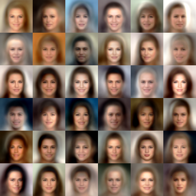


With the same two-pass schedule and the same bottleneck and RGB competition settings, the model with one extra layer on each side scored **185.38**, compared with **191.71** for the shallow model. Validation selected the deeper checkpoint after two passes and the shallow checkpoint after one pass. The one-pass experiments with two extra encoder layers, two extra decoder layers, or two on both sides scored **233.52**, **233.63**, and **239.77**, respectively.

The winning run uses Lion-style local coactivity, batches of 128, and a starting RGB layer step of **0.0008**. All encoder layers and the decoder hidden layer start at **0.00012**. The first encoder layer keeps 768 winners per pool. The added encoder and decoder layers use Gaussian widths of 0.85 and 0.50, respectively. All 256 bottleneck values pass through. Fixed subtraction of the two activity magnitudes in each output pair gives one RGB value. With the trained weights fixed, validation selected an RGB Gaussian width of **0.40** for inference, lowering the test error from 185.38 to 184.19. [Full run settings and validation checks](assets/results/celeba-256.json)

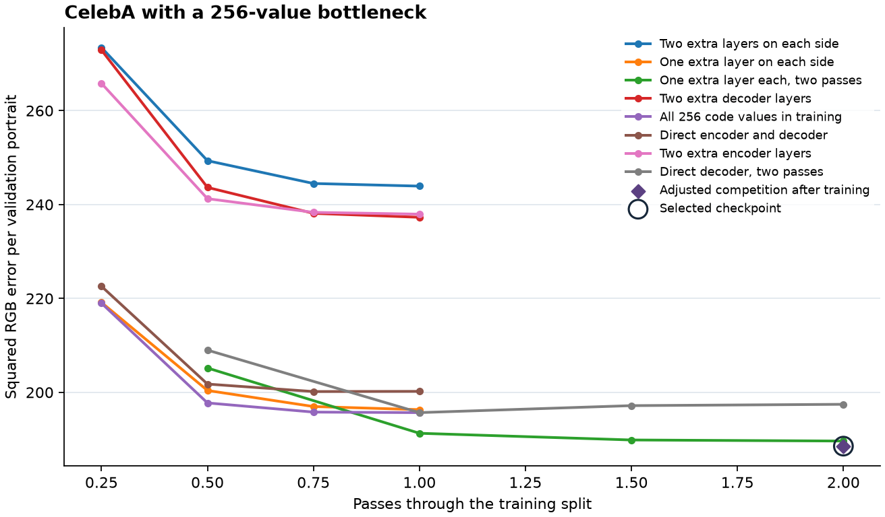

For training, use the CelebA command with the following settings. Add `--vector-gate-width .40` to the reconstruction and sampler commands for the selected checkpoint. [CelebA data and commands](papers/README.md#celeba)

```bash
python -m experiments.celeba "$face_archive" --partitions "$face_partitions" --output "$run" \
  --backend mojo --full-only --full-epochs 2 --checks-per-epoch 2 --reconstruction-only \
  --decoder vector --encoder-width 3072 --encoder-hidden-widths 1536 --latent-width 256 \
  --encoder-top-k 768 86 --encoder-gate-widths .85 .85 --vector-hidden-width 256 \
  --projected-encoder-votes --projected-decoder-votes --center-encoder --decoder-rate-decay .15 \
  --encoder-rate .15 --decoder-init-scale .12 --vector-gate-width .44 --images-per-batch 128 \
  --rule lion --rate .0008
```

##### One further layer on each side

Adding a 768-neuron encoder layer and a second 1,536-neuron decoder layer gives **12,288 → 3,072 → 1,536 → 768 → 256 → 1,536 → 1,536 → 24,576** with **84,378,112** learned weights and biases. Both layouts use the two-pass schedule above. At the training settings, the deeper model scored **232.82** on the official test split, compared with **185.38** for the previous layout. Adjusting the RGB Gaussian width on validation gave final test scores of **232.07** and **184.19**, respectively. The deeper model's validation error fell by only 0.04 in the last half pass. [Training curves](assets/results/celeba-256-extra-depth.png) · [Run settings and measurements](assets/results/celeba-256-extra-depth.json)

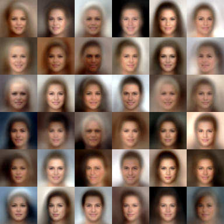

For the added layers, set `--encoder-hidden-widths 1536 768` and `--vector-hidden-depth 2` in the training command above. Use `--vector-gate-width .42` in the reconstruction and sampler commands.

##### Smaller starting steps on the seven-layer model

All runs use the same 256-value bottleneck, 84,378,112 parameters, and cosine schedule shape. Validation selected the checkpoint in each run. The table reports test error with the training RGB Gaussian width of 0.44.

| Starting RGB step | Scheduled passes | Selected pass | Test RGB error ↓ |
|---:|---:|---:|---:|
| 0.0008 | 2 | 2 | 232.82 |
| **0.0006** | **2** | **2** | **231.66** |
| 0.0004 | 2 | 2 | 240.36 |
| 0.0004 | 4 | 2.5 | 232.18 |

At the validation-selected RGB Gaussian width of 0.42, lowering the starting step from 0.0008 to 0.0006 reduced test error from **232.07 to 230.91**. The four-pass 0.0004 run has roughly the same cumulative scheduled step as the two-pass 0.0008 run. Its best checkpoint occurs at 2.5 passes. To reproduce the best smaller-step run, use `--rate .0006` with the added-layer training command above. [Training curves](assets/results/celeba-256-smaller-step.png) · [Run settings and measurements](assets/results/celeba-256-smaller-step.json)

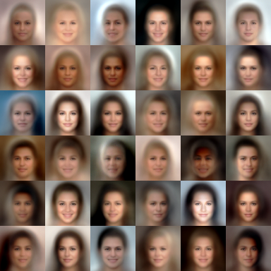

<details>
<summary>Earlier CelebA experiments with other bottleneck widths</summary>

#### 512-value bottleneck

The best **512-value** autoencoder scores **161.16** squared RGB error per test image. It maps **12,288 → 6,144 → 512 → 24,576** with **91,257,344** learned weights and biases. The embedding has one twenty-fourth as many values as the input. Test error sums squared RGB differences on a 0–1 scale and averages them across all 19,962 official CelebA test images.

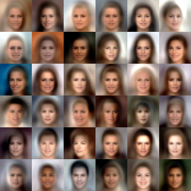

| Bottleneck values | Learned parameters | Test RGB error ↓ |
|---:|---:|---:|
| **512** | **91,257,344** | **161.16** |
| 3,072 | 169,903,104 | 112.38 |
| 4,096 | 201,361,408 | 105.32 |

The 512-value model trains for one pass with Lion-style local coactivity, 1,536 winners per first encoder pool, 128 winners per bottleneck pool, and a Gaussian RGB width of 0.46. With the trained weights fixed, validation favored retaining all 512 embedding values and using an RGB width of 0.44. That changed the test error from **164.49** to **161.16**. Two scheduled passes gave **164.37** at the checkpoint selected after one pass. Separately, changing the 4,096-value model's RGB width from 0.50 to 0.46 lowered its error from **106.78** to **105.32** with its saved weights. [Runs and validation checks](assets/results/celeba-refinement.json)

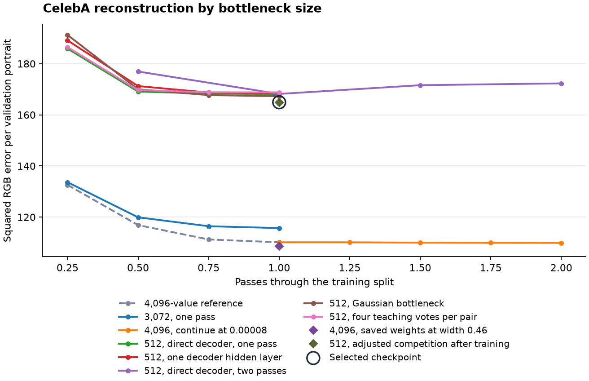

To reproduce the 512-value result, use the CelebA training command with `--encoder-width 6144 --latent-width 512 --rate .0014 --encoder-top-k 1536 128 --vector-gate-width .46` and a new output directory. Add `--code-top-k 172 --vector-gate-width .44` to the reconstruction and sampler commands. A count of 172 keeps every value in the bottleneck pools of 172, 172, and 168. [CelebA data and commands](papers/README.md#celeba)

#### Top-K comparison

The 4,096-value model maps **12,288 → 6,144 → 4,096 → 24,576**. Its decoder receives only the bottleneck and produces an increase/decrease pair for each RGB value. All layers train by Lion-style local coactivity.

The best model keeps the **1,536** largest activation magnitudes in each first-layer pool of 2,048 and the **1,024** largest in each bottleneck pool of 1,366, 1,366, and 1,364. Winners retain their original signed activity. All other activities are zeroed. Each pool contains both classes. The output keeps Gaussian competition of width **0.50** within each RGB pair.

| Encoder | RGB output | Initialization | Test RGB error ↓ |
|---|---|---|---:|
| **Top-K** | **Gaussian** | **Independent** | **106.78** |
| Top-K | Both neurons unscaled | Gaussian checkpoint | 115.53 |
| Gaussian | Gaussian | Independent | 119.24 |
| Top-K | Both neurons unscaled | Independent | 125.40 |

The 106.78 and 119.24 runs differ only in encoder competition. Both use one pass through 162,770 training images in batches of 128. The decoder starts at **0.0014** and both encoder layers at **0.00021**. Validation selected the best Top-K checkpoint at the end of the pass. The continuation started from the Gaussian checkpoint at a decoder step of 0.00012 and selected its checkpoint after a further quarter pass. In the 4,096-image training pilot, the all-hard model kept about 90% of the encoder activations and one winner per RGB pair. Its validation error was **175.59**, compared with **139.33** for the Gaussian control. [Run settings and measurements](assets/results/celeba-topk.json)

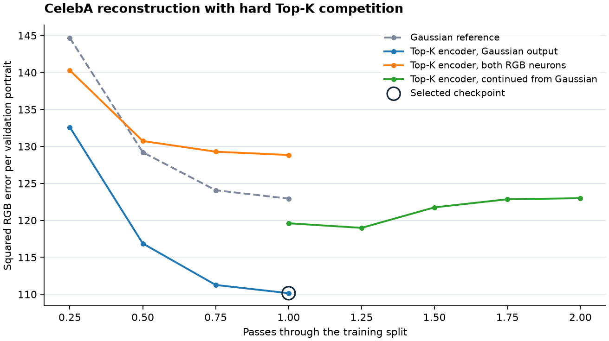

To reproduce the best score, use the training and reconstruction commands with `--encoder-width 6144 --latent-width 4096 --rate .0014 --encoder-top-k 1536 1024` and a new output directory. The image panel uses the 16-component sampler described there, fitted to the selected Top-K model's training embeddings. [CelebA data and commands](papers/README.md#celeba)

#### Lower-step training

The Gaussian 4,096-value model starts the decoder at **0.0014** and both encoder layers at **0.00021**, using the same hold and cosine schedule as the manuscript. Validation selected the checkpoint after one pass through 162,770 training images, in batches of 128. The 2,048-value model reached **126.88** with a 0.0006 decoder step and two passes. [Run settings and checkpoint measurements](assets/results/celeba-target120.json)

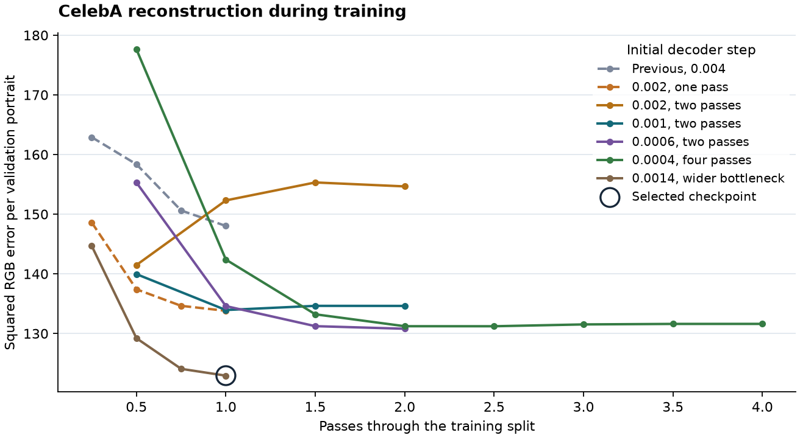

To reproduce the 4,096-value reconstruction score, use the training and reconstruction commands with `--encoder-width 6144 --latent-width 4096 --rate .0014` and a new output directory. [CelebA data and commands](papers/README.md#celeba)

#### Training the standard sequential model

The original full-data runs below use one pass through all 162,770 training images. All used 128 images per minibatch, a starting decoder step of 0.004, and an encoder step of 0.0006. The validation panel selected checkpoints.

| Encoder → embedding | Decoder initialization scale | Decoder Gaussian width | Local update | Test RGB error ↓ |
|---|---:|---:|---|---:|
| 3,072 → 2,048 | 0.12 | 0.5 | Lion-style | 144.21 |
| 6,144 → 4,096 | 0.12 | 0.5 | Memoryless | 146.68 |
| 3,072 → 2,048 | 0.12 | 0.5 | Memoryless | 146.71 |
| 3,072 → 2,048 | 0.04 | 0.24 | Memoryless | 151.57 |
| 3,072 → 2,048 | 0.12 | 0.24 | Memoryless | 153.24 |
| 3,072 → 2,048 | 1 | 0.24 | Memoryless | 228.04 |

The larger-batch run with the original initialization scored 228.04. Reducing the scale of the independent decoder weights and biases brought it down to 153.24, and widening output competition reduced it further. The 4,096-value pilot also reached 149.30 after training on 4,096 images. [Run settings, checkpoint measurements and export checksum](assets/results/celeba-target150.json)

#### Earlier tuning of the sequential architecture

We screened 26 settings and trained six configurations on the full split. The screen varied encoder and embedding widths, zero to three additional decoder hidden layers, starting steps, Gaussian competition width and output initialization. The pilot used 4,096 training images and 512 validation images. Full-data runs used all 162,770 training images. Validation chose the checkpoint and model. Each test error sums squared differences across RGB values on a 0–1 scale and averages over all 19,962 official test images.

| Encoder → embedding | Output initialization | Gaussian width | Initial decoder step | Validation RGB error ↓ | Test RGB error ↓ |
|---|---|---:|---:|---:|---:|
| 3,072 → 2,048 | Independent | 0.24 | 0.004 | 234.37 | 229.47 |
| 3,072 → 2,048 | Independent | 0.50 | 0.004 | 221.84 | 217.98 |
| **3,072 → 2,048** | **Opposite pairs** | **0.24** | **0.004** | **193.37** | **188.68** |
| 768 → 512 | Opposite pairs | 0.24 | 0.004 | 237.34 | 232.90 |
| 1,536 → 1,024 | Independent | 0.24 | 0.012 | 307.30 | 303.74 |
| 1,536 → 1,024 | Independent | 0.50 | 0.009 | 238.51 | 234.60 |

The pilot favored the larger steps for some short runs. On the full split, the best result came from changing the output initialization. We set the decrease neuron's initial incoming weights and bias to the negatives of its increase partner's. The two activity magnitudes start equal, so their difference is zero. All three layers update from signed RGB errors throughout one training pass. The decoder starts at 0.004 and the encoder layers at 0.0006. The step holds for the first fifth of the pass and then decays with a cosine. The 512-value paired model also improves the earlier sequential result with 22,439,168 parameters.

Across 864 matched draws per model, the tuned 2,048-value model lowers measured color grain from 0.098 to 0.060 and increases variation in facial edges from 0.560 to 0.756 compared with the earlier 512-value three-layer decoder. Many faces still share similar poses. [All settings, scores and sampler records](assets/results/celeba-sequential.json)

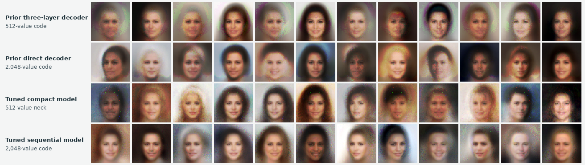

#### Earlier decoder experiments

The earlier concatenated generator uses **three 768-neuron decoder hidden layers after two training passes**. Across 864 decoder seeds, the second pass increased facial-edge spread from **0.765 to 0.793** and slightly reduced measured color grain. The first-pass checkpoint had a test reconstruction error of **202.42**. All layers train with local signed Hebbian updates on the encoder's exact embeddings. [Before-and-after samples and convergence curves](#a-second-pass-for-the-deeper-decoders)

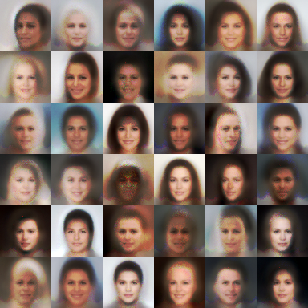

#### Decoder connected only to its last hidden layer

We initially compared the concatenated decoder, which sends the embedding and all three hidden layers to the RGB layer, with a sequential decoder of the same widths. The sequential path is **12,288 → 768 → 2,048 → 768 → 768 → 768 → 24,576**, followed by fixed pair subtraction to 12,288 RGB values. The RGB layer receives only the last 768 activities. We also tried **12,288 → 768 → 512 → 768 → 768 → 768 → 24,576**, with the 512-value embedding the narrowest layer. All six dense layers learn from the signs of the final RGB errors.

Each model trains on all 162,770 training images for two passes. The RGB layer starts at 0.004 in the first pass and 0.0002 in the second. Every earlier layer uses 15% of these steps. The batch size is 32 and the cosine starts after the first fifth of each pass. The first pass uses the lowest-error checkpoint on the same 512 training images to start the second pass. We compare all models at the end of the second pass.

| Decoder | Trainable parameters | Test RGB error, first pass | Test RGB error, second pass | Generated facial-edge spread | Generated color grain |
|---|---:|---:|---:|---:|---:|
| Embedding and all three hidden layers | 120,747,008 | 202.42 | 203.79 | 0.793 | 0.0718 |
| Last hidden layer only, 2,048-value embedding | 32,666,624 | 362.85 | 370.10 | 0.543 | 0.0969 |
| Last hidden layer only, 512-value neck | 30,305,792 | 348.58 | 353.30 | 0.560 | 0.0975 |

Test RGB error sums squared differences across RGB values on a 0–1 scale, then averages over all 19,962 test images. At the same layer widths, connecting only to the last layer cuts the RGB layer's input width from 4,352 to 768 and reduces the model's parameter count by 73%. With these settings, the sequential decoder produces blurrier reconstructions and more mottled colors. The 512-value neck lowers the sequential model's reconstruction error. It retains useful image information: giving it another image's embedding raises the error from 353.30 to 1,486.08.

The generation columns use 864 draws per model, with a separate fit of the same 16-component, rank-64 sampler for each model. Edge spread measures variation in the outlines and lighting of generated faces. The panels use the same random draws in each row. [Settings and measured results](assets/results/celeba-decoder-connections.json)

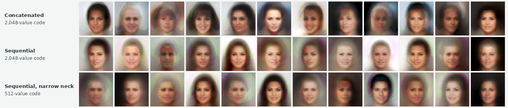

Use the aligned archive described in the [data instructions](papers/README.md#celeba). The following commands train the two earlier sequential models. The comparison command also reads the concatenated model's export listed in the run record. The argument list assumes the ZIP contains the official evaluation partition list. Add `--partitions /path/to/list_eval_partition.txt` to `common` if the list is separate.

```bash
face_archive=/path/to/img_align_celeba.zip
root=runs/celeba-capacity
common=(
  "$face_archive" --backend mojo --full-only --full-epochs 1 --select-on-training
  --decoder vector --encoder-width 768 --encoder-gate-widths .5 .5
  --projected-encoder-votes --center-encoder --encoder-rate .15
  --vector-hidden-width 128 --vector-hidden-depth 3
  --projected-decoder-votes --decoder-rate-decay .15
)
for code in 2048 512; do
  if [ "$code" = 2048 ]; then name=decoder-last768x3; else name=decoder-neck512; fi
  first="$root/$name"
  second="$root/$name-pass2"
  OPENBLAS_NUM_THREADS=2 python -m experiments.celeba "${common[@]}" --latent-width "$code" \
    --output "$first" --rate .004
  OPENBLAS_NUM_THREADS=2 python -m experiments.celeba "${common[@]}" --latent-width "$code" \
    --output "$second" --rate .0002 --checks-per-epoch 4 \
    --initialize-from "$first/full/selected.npz"
  OPENBLAS_NUM_THREADS=4 python -m experiments.celeba_prior "$second/full" --checkpoint latest \
    --components 16 --local-rank 64 --local-scale .85 --output "$second/full/end-decoder-mixture.npz"
done
OPENBLAS_NUM_THREADS=2 python -m experiments.celeba_decoder_connections
```

The comparison command also saves a local sheet with test images and each model's reconstruction at `runs/celeba-capacity/decoder-connections/reconstruction.png`.

#### Direct decoder baseline

The direct decoder with a **2,048-value embedding** completed one pass over all **162,770 training images**. Summed squared RGB error fell from **245.8 to 215.2 per training image**, a **12.5% reduction** from the 1,024-value model. On the official 19,962-image test split it fell from **244.9 to 214.6**. Each score sums squared differences across all RGB values on a 0–1 scale, then averages across images. [Direct decoder run, architecture, and checksum](assets/results/celeba.json)

Across two blocks of 216 seeds, the direct generator with a wider bottleneck raised the average spread of smoothed grayscale facial edges from **0.676 to 0.730** and lowered the mean gap between generated and held-out brightness quantiles from **0.014 to 0.011**. This edge measure captures some lighting variation along with facial structure. The samples still lean toward front-facing, feminine-looking faces, and some show visible grain. [Width and sampler measurements](assets/results/celeba-width-comparison.json)

#### Matched width and sampler comparisons

| Encoder layer widths | Trainable parameters | Training RGB error | Test RGB error | Training panel facial-edge error |
|---|---:|---:|---:|---:|
| 768 → 1,024 | 35,415,808 | 245.8 | 244.9 | 0.410 |
| 1,536 → 1,024 | 45,640,192 | 251.5 | 250.5 | 0.421 |
| **768 → 2,048** | **61,369,088** | **215.2** | **214.6** | **0.357** |

All three models used seed 7 and the same full-data schedule. On a fixed panel of 2,048 training images, the larger embedding better preserved facial edges associated with eyeglasses and open-mouth smiles. Facial-hair contrast was essentially flat. The local contact sheet shows the same 18 original images beside each model's reconstructions, with visible losses in fine detail. [Earlier capacity experiments](assets/results/celeba-capacity.json)

| Sampled directions per component | Facial-edge spread ↑ | Brightness quantile error ↓ | High-frequency chroma ↓ |
|---|---:|---:|---:|
| 20 | 0.683 | 0.008 | 0.066 |
| **64** | **0.730** | **0.011** | **0.077** |
| 128 | 0.778 | 0.007 | 0.084 |

The table averages the two seed blocks with the same decoder, Gaussian components, and scale. The selected 64-direction export increases edge spread while keeping high-frequency chroma close to the previous published generator. The 128-direction export spreads further and shows more color grain. [Matched sample grids](assets/results/celeba-width-sampling.png)

#### Direct decoder architecture

| Stage | Layer sizes | Trainable weights and biases |
|---|---|---:|
| First encoder layer | 12,288 → 768 | 9,437,952 |
| Encoder bottleneck layer | 768 → 2,048 | 1,574,912 |
| Image-vector decoder | 2,048 → 24,576 | 50,356,224 |
| Fixed pooling | 24,576 → 12,288 RGB values | 0 |
| **Total** | | **61,369,088** |

The encoder subtracts the same training-set feature mean vector from every flattened image. Its first layer has three Gaussian pools of 256 neurons, each with 128 increase and 128 decrease neurons. Its second layer has pools of 684, 684, and 680 neurons containing complete increase/decrease pairs. Both encoder layers use Gaussian width **0.50**. The decoder computes the whole image in one dense pass. Each output scalar has a two-neuron pool of Gaussian width **0.24**, with one increase neuron and one decrease neuron. Fixed pooling subtracts their activity magnitudes, then clips and rounds to 8-bit RGB.

Each minibatch contains 32 images. For each output scalar, the quantized target minus the quantized prediction supplies the teaching sign. Matching values supply a zero sign. A fixed random permutation assigns output coordinates to pairs in each encoder layer, with 32 votes per pair in the first layer and 12 in the bottleneck layer. Half of a pair's votes carry a positive multiplier and half carry a negative one. The sum of these votes, multiplied by the neuron's class polarity, teaches each neuron through local presynaptic and postsynaptic coactivity. The coactivity and activity-power denominators count all nonzero votes, including those that cancel. All three dense layers train on each minibatch. The decoder step starts at **0.004** and the encoder step starts at **0.0006**. The schedule holds them for the first fifth of the run and then decays them to zero with a cosine. The training error on a fixed 512-image panel selects the checkpoint. [Local update equations](#network-and-updates)

The decoder export uses **16 Gaussian components** computed from the training embeddings. Grouping uses the eight leading standardized embedding directions. Each component retains its 64 largest covariance directions and scales their standard deviations by **0.85**. A seed chooses a component by training frequency and draws a fresh embedding for the decoder.

Use a local ZIP of the aligned CelebA JPEGs and pass `--partitions` if the official split list is separate. [CelebA data and research terms](https://mmlab.ie.cuhk.edu.hk/projects/CelebA.html)

```bash
python -m experiments.celeba /path/to/celeba.zip --backend mojo --full-only \
  --full-epochs 1 --select-on-training --output runs/celeba-capacity/fixed768x2048 \
  --decoder vector --encoder-width 768 --latent-width 2048 \
  --encoder-gate-widths .5 .5 --projected-encoder-votes --center-encoder --encoder-rate .15
python -m experiments.celeba_prior runs/celeba-capacity/fixed768x2048/full \
  --components 16 --local-scale .85 --local-rank 64 \
  --output runs/celeba-capacity/fixed768x2048/full/decoder-mixture.npz
python -m hebbian_fit.autoencoder runs/celeba-capacity/fixed768x2048/full/decoder-mixture.npz \
  --seed 42 --output face.png
```

#### Decoder depth and output width

All six models used seed 7, 162,770 training images, and the same one-pass schedule. The projected-vote decoder variants also used a smaller step for their added hidden layer.

| Decoder variant | Trainable parameters | Training RGB error | Test RGB error |
|---|---:|---:|---:|
| Published baseline | 61,369,088 | 215.2 | 214.6 |
| Two output pairs, 2,048-value embedding | 111,725,312 | 242.8 | 242.4 |
| Two output pairs, 1,024-value embedding | 60,606,208 | 268.4 | 267.6 |
| Sequential decoder layer | 65,671,940 | 645.0 | 638.0 |
| Sequential layer with projected votes | 65,671,940 | 248.6 | 247.8 |
| **Decoder layer with skip connection** | **81,817,088** | **208.7** | **208.2** |

In the initial decoder comparison, the lowest reconstruction error came from a **768-neuron layer with a skip connection**. The RGB layer receives the 2,048 original embedding values together with the 768 learned activations. The extra layer uses balanced votes from the final signed residuals and starts at a step of 0.0006. All layers train together.

An additional low-rate pass started from the published checkpoint. The baseline scored **214.7** on the fixed checkpoint panel after the pass, so selection kept its original weights. The run with an added skip layer started from the same predictions and lowered that panel score from **213.2 to 211.2**. Its selected test error was **213.1**. [Run settings and measurements](assets/results/celeba-decoder-comparison.json)

On the fixed reconstruction panel, the skip decoder better preserved the facial-edge differences associated with open-mouth smiles and head angle. Eyeglass contrast fell slightly. Across the same 432 sampler seeds, generated facial-edge spread averaged **0.716** for the skip decoder and **0.730** for the direct decoder. Both produced comparable high-frequency chroma. The wider two-pair output raised spread to **0.739** and increased high-frequency chroma by **32%**. [Matched decoder samples](assets/results/celeba-decoder-sampling.png)

```bash
python -m experiments.celeba /path/to/celeba.zip --backend mojo --full-only \
  --full-epochs 1 --select-on-training --output runs/celeba-capacity/decoder-skip768 \
  --decoder vector --encoder-width 768 --latent-width 2048 \
  --encoder-gate-widths .5 .5 --projected-encoder-votes --center-encoder --encoder-rate .15 \
  --vector-hidden-width 128 --vector-decoder-skip --projected-decoder-votes --decoder-rate-decay .15
python -m experiments.celeba_prior runs/celeba-capacity/decoder-skip768/full \
  --components 16 --local-scale .85 --local-rank 64 \
  --output runs/celeba-capacity/decoder-skip768/full/decoder-mixture.npz
```

#### Extra pass from the one-layer skip checkpoint

A second pass initialized from the 208.2-test-error skip decoder, with an initial step of 0.0004 for the output layer and 0.00006 for the earlier layers. The training-panel errors before the pass and at each quarter were **206.67**, 208.13, 208.51, 207.82, and 207.79. Selection kept the starting weights. On the 19,962 test images, the end-of-pass weights scored **209.75**, up from **208.25** at the start. The selected decoder reproduced the same samples across the two seed blocks. [Continuation settings and measurements](assets/results/celeba-decoder-comparison.json)

To reproduce the continuation, use the skip-decoder training command above with a new output directory and add `--rate .0004 --checks-per-epoch 4 --initialize-from runs/celeba-capacity/decoder-skip768/full/selected.npz`.

#### Stacking hidden layers in the decoder

| Decoder hidden layers × neurons | Trainable parameters | Training RGB error ↓ | Test RGB error ↓ | Generated facial-edge spread | Generated color grain ↓ |
|---|---:|---:|---:|---:|---:|
| Direct decoder | 61,369,088 | 215.17 | 214.56 | 0.730 | 0.0772 |
| 1 × 768 | 81,817,088 | 208.70 | 208.25 | 0.716 | 0.0775 |
| 1 × 1,536 (width control) | 102,265,088 | 204.20 | 203.59 | 0.783 | 0.0780 |
| 2 × 768 | 101,282,048 | 204.80 | 204.40 | 0.787 | 0.0762 |
| 3 × 768 | 120,747,008 | 202.91 | 202.42 | 0.747 | 0.0733 |

Three layers reduced the average sum of squared RGB differences per test image by **2.8%** relative to one 768-neuron layer. The width control also improved reconstruction. It scored **203.59** with essentially the same parameter count and exactly the same RGB-layer input width as the two-layer model (**204.40**). This single training seed leaves the independent benefit of depth uncertain.

Two layers raised the average facial-edge spread from **0.716 to 0.787**, about **10%**. The wide control reached **0.783**, and which of these two led changed between the two seed blocks. Three layers gave the lowest color grain and a closer match to the contrast distribution of real images. For context, the 512 real reference images had facial-edge spread **1.301** and color grain **0.0229**. Lighting affects the edge measurement, and several generated faces still have mottled shadows. The spread measure cannot determine how many distinct identities a model produces. [Settings, per-block measurements, and decoder checksums](assets/results/celeba-decoder-depth.json)

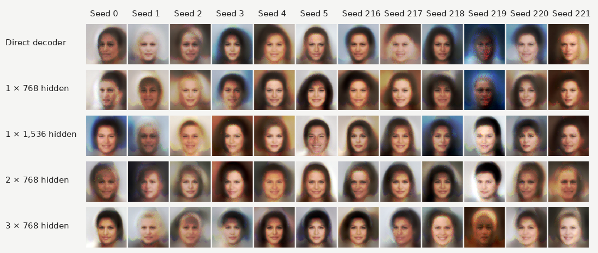

Every model learns a 2,048-value face embedding with the same encoder architecture. With two hidden layers, the first maps 2,048 → 768 and the second maps 768 → 768. The output layer receives the concatenation of the embedding and both layers, giving it 3,584 inputs. A third 768 → 768 layer brings that to 4,352 inputs. All variants use 24,576 output neurons and fixed increase/decrease pooling for the 12,288 RGB values.

Every hidden layer uses its own fixed permutation of the final pixel signs. Each pair in a 768-neuron layer gets 32 signed votes, half with each polarity. Each hidden layer starts at the same 0.0006 step and the output layer starts at 0.004. The encoder, minibatch order, one-pass cosine schedule, and sampler settings match the one-layer experiment. Training uses the encoder's exact embedding for each image.

To reproduce the two- or three-layer runs, use the one-layer skip training command above with `--vector-hidden-depth 2` or `--vector-hidden-depth 3` and a separate output directory. For the wide one-layer control, use `--vector-hidden-width 256 --vector-hidden-depth 1`. Each unit of this width adds one increase and one decrease neuron for each of the three color channels. Use the same mixture-export command on each run directory. For example, these commands export and sample the two-layer decoder after training.

```bash
run=runs/celeba-capacity/decoder-skip768x2/full
python -m experiments.celeba_prior "$run" --components 16 --local-rank 64 --local-scale .85 \
  --output "$run/decoder-mixture.npz"
python -m hebbian_fit.autoencoder "$run/decoder-mixture.npz" --seed 42 --output face.png
```

For each trained decoder, `python -m experiments.celeba_diversity --seed-start 0 --output comparison/0 model="$run/decoder-mixture.npz"` scores seeds 0–215. Repeating with `--seed-start 216 --output comparison/216` scores seeds 216–431.

#### A second pass for the deeper decoders

Both models completed another pass over the same 162,770 CelebA training images in the original seed-7 minibatch order. The output step restarted at **0.0002**, one twentieth of its initial training value. All earlier layers restarted at **0.00003**. The schedule held those steps for the first 20% of the pass, then decayed them to zero with a half cosine. The 512-image training panel chose between the starting weights and four evenly spaced checkpoints.

| Decoder | Test RGB error, before → after ↓ | Generated facial-edge spread, before → after | Color grain, before → after ↓ |
|---|---:|---:|---:|
| 2 × 768 | 204.40 → 205.29 | 0.785 → 0.775 | 0.0766 → 0.0742 |
| 3 × 768 | 202.42 → 203.79 | 0.765 → 0.793 | 0.0733 → 0.0718 |

Reconstruction error stayed above its starting value at every check for both models. The table scores the actual end-of-pass weights on all 19,962 test images. Both reconstruction-selected checkpoints retained their starting weights.

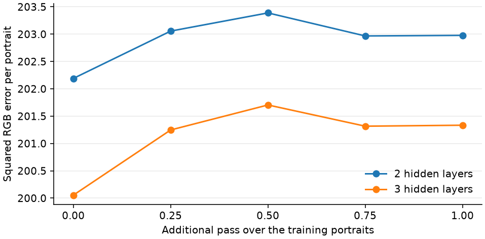

For generation, each endpoint received a fresh fit of the same 16-component, rank-64 sampler using its training embeddings. The generation columns average four blocks of 216 seeds. On the original 432 seeds, two-layer spread rose from 0.787 to 0.827, but on 432 fresh seeds it fell from 0.784 to 0.724. Three-layer spread rose on both sets, from 0.747 to 0.759 and from 0.783 to 0.827. On all 864 seeds its increase was **0.028**, with a paired seed-bootstrap 95% interval of **0.002 to 0.054**. This measures variation in facial edges, which also respond to lighting. The interval covers sampling variation for this one trained model. [Measurements, checkpoints, and exports](assets/results/celeba-extra-pass.json)

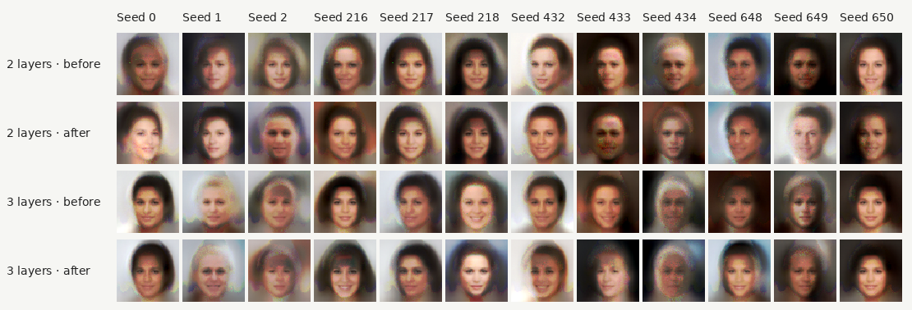

To repeat the continuation for either depth, add `--rate .0002 --checks-per-epoch 4 --initialize-from` followed by that depth's first-pass `full/selected.npz` to its one-pass training command, and choose a new output directory. To sample the featured second-pass weights, use the endpoint export.

```bash
python -m hebbian_fit.autoencoder runs/celeba-capacity/decoder-skip768x3-pass2/full/end-decoder-mixture.npz \
  --seed 42 --output face.png
```

</details>

### NASA Blue Marble

The network maps raw $(x,y)$ coordinates to RGB on the bundled 128 × 128 crop of Apollo 17 frame AS17-148-22727. Each color channel has an increase class and a decrease class. Every coordinate passes through the same dense network. [NASA Johnson Space Center source photograph](https://science.nasa.gov/resource/the-blue-marble/)

All **16,384** original pixels participate in training and checkpoint selection.

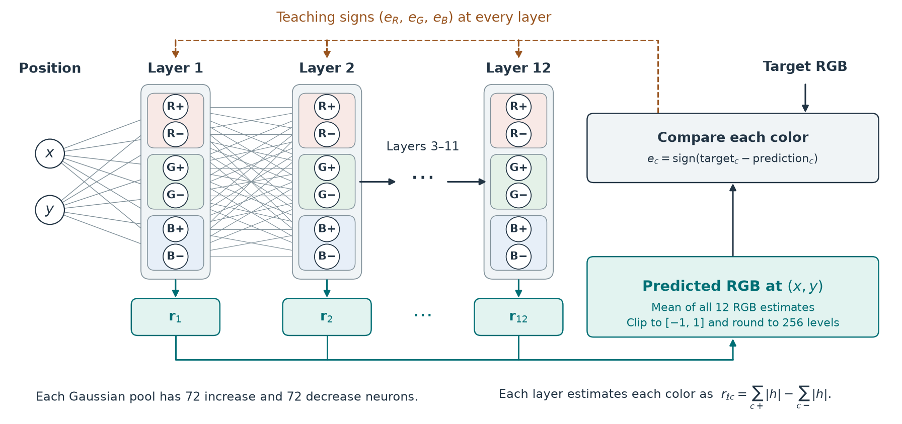

The network maps $(x,y)$ through **12 dense hidden layers of 432 neurons** to three RGB outputs. Each hidden layer contains 72 increase and 72 decrease neurons per channel. Each channel's two classes share one Gaussian competition pool. The widths, in layer order, are 0.240, 0.225, 0.211, 0.196, 0.182, 0.167, 0.153, 0.138, 0.124, 0.109, 0.095 and 0.080. The first layer has 1,296 affine parameters and the remaining layers have 187,056 each, for **2,058,912 trainable weights and biases**. Weight initialization uses a zero-mean normal distribution with standard deviation $1/\sqrt{\text{fan-in}}$, and biases use standard deviation 0.35.

For each color, subtract the decrease-class magnitude sum from the increase-class magnitude sum in each layer. Average those 12 signed values, then clip and round to 8-bit RGB. Every hidden layer trains by local Hebbian coactivity using the sign of the final RGB residual. A matching channel supplies a teaching sign of zero.

The **Blue Marble baseline** uses semi-implicit Lion with one 560-epoch cosine starting at 0.004 and batches of 128. Each neuron adjusts its step from the agreement between its latest Hebbian coactivity and its running history. The rule is identical across layers and uses no settings tied to layer depth.

The fit reaches **6.82** summed squared RGB error at epoch 560. [Convergence](assets/results/blue-marble-shared-step-lion-adaptive-agreement-0.004.png) · [Per-layer images](papers/figures/earth-layers.pdf) · [Reproduction commands](papers/README.md#one-shared-timestep-with-sign-agreement)

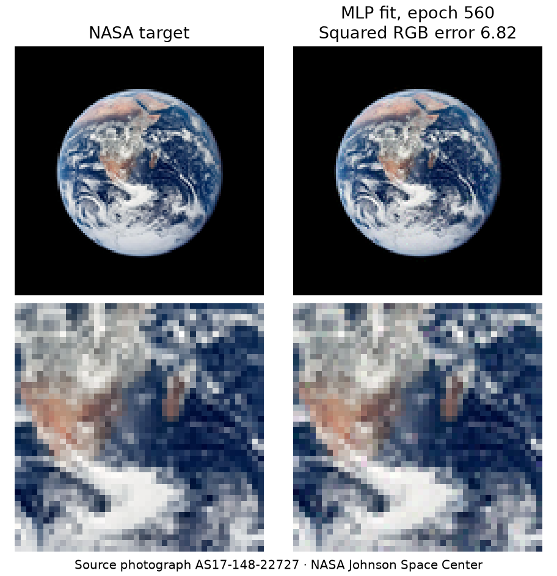

### Sine wave with a jump at the crest

The target is $f(x)=0.5\sin(2\pi x)+0.5\,\mathbf{1}_{x>0.25}$. Its left and right slopes approach zero at the crest, where the value jumps from 0.5 to 1.0. The MLP receives only raw coordinates. Each of the training, validation and test grids contains 4,096 points.

The best fit uses 24 hidden layers of 64 neurons, with Gaussian widths tapering from 0.320 to 0.160. It trains for 640 epochs in batches of 64 with the same update as Blue Marble and one cosine starting at 0.00075. Median test RMSE is **0.01103** across the training interval and **0.00463** away from the jump. [Training settings and comparison](papers/README.md#discontinuous-sine)

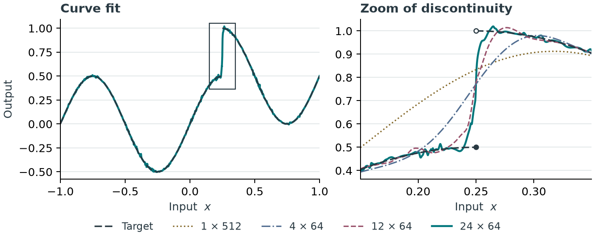

## Network and updates

For each output channel the network assigns one increase class and one decrease class. Scalar regression has two classes and RGB has six. Every hidden neuron receives every input from the preceding layer. A neuron with $F$ inputs and $K$ coefficients per edge trains $KF+1$ parameters, including its bias. Affine edges use one weight. Continuous two-piece edges use three endpoint heights, and discontinuous edges use four at $-1,0^-,0^+,1$. A piecewise edge linearly interpolates on each side and extrapolates outside the endpoints. Its interpolation coefficients serve as presynaptic activities during training.

With `--connection discontinuous`, the optional `--edge-transitions` setting takes one half-width $w$ per layer. For each incoming activity $u$, set $t=\operatorname{clip}((u/w+1)/2,0,1)$ and $q=t^2(3-2t)$, then combine the two lines $L$ and $R$ as $(1-q)L(u)+qR(u)$. This preserves the original lines outside the band and joins them with a continuous slope. A width of zero uses a sharp switch at zero.

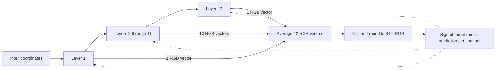

Each neuron applies the selected gate to its preactivation, optionally after applying a sine activation. The hard gate keeps the largest magnitudes with stable index ordering for ties. The Gaussian and tent gates scale every signed activity. Competition can use one pool per class, one pool per output channel containing both of its classes, or one pool for the whole layer. For Gaussian width $\tau$, pool maximum $m>0$ and activation $z$, the multiplier is $\exp[-\min((m-|z|)/(m\tau),13)^2/2]$. An all-zero pool remains zero. The optional `gaussian-smooth` uses $m=\sqrt{\sum_i z_i^{16}/\sum_i z_i^{14}}$ in the same Gaussian. This center varies smoothly when the strongest neuron changes. With `gaussian-dual`, adjacent neurons alternate between $0.75\tau$ and $1.25\tau$, dividing each class evenly between the two widths. All neurons in a competition pool use the same maximum. Tent scaling uses the same relative distance and a floor of 0.01. The ungated option passes each activity through.

For output channel $k$, define $U_k$ and $D_k$ as the sums of the magnitudes in its increase and decrease classes. `--readout class-sum` returns $U_k-D_k$. The default `fixed` divides this difference by the number of neurons per class for a scaled or ungated layer, or by the configured winners per class for a hard gate. `sum` adds the original signed activities in both classes. By default only the final hidden layer contributes. With `--readout-layers all`, these three readouts average the fixed pools from every layer.

The optional `--readout class-energy --readout-layers all` implements the paper's class energy for a dense network. For each output, subtract the decrease-class score from the increase-class score. Each score sums the layers' squared activities divided by the per-class count $K_\ell$. With Gaussian competition, every neuron participates, so $K_\ell$ is the class width. With hard competition, the denominator is the configured winner count per class. All layers' normalized energies are **summed** before any output clipping or rounding. The residual of the resulting signed value supplies the usual teaching sign. [Paper scoring rule](https://arxiv.org/html/2611.24314v1#S2.SS2)

The image command defaults to 256 levels over $[-1,1]$ with clipping enabled. Predictions and targets are rounded at the same spacing, which is $2/255$ in this case. Use `--no-clip-output` to allow predictions beyond the nominal range to supply signed corrections. PNG rendering limits RGB to its display range. Use `--output-levels 0` for continuous values.

For each minibatch, compute the prediction first. Hidden neuron $j$ receives $s_j=\sigma_j\operatorname{sign}(y_k-\hat y_k)$, where $\sigma_j$ is its class polarity. For samples with nonzero $s_j$ and postsynaptic activity $h_j$, form the local means $A_{ij}=\operatorname{mean}(u_i s_j h_j)$ and $Q_j=\operatorname{mean}(h_j^2)$. The bias input is one. Skip a neuron when it has no contributing samples. The update direction uses this local coactivity statistic.

Both Lion updates use $D_{ij}=\operatorname{sign}(0.125m_{ij}+0.875A_{ij})/\sqrt{KF+1}$, then set $m_{ij}\gets0.99m_{ij}+0.01A_{ij}$. The history starts at zero.

- `--hidden-rule lion` applies the semi-implicit update $w_{ij}\gets(w_{ij}+\eta D_{ij})/(1+\eta Q_j)$.
- `--hidden-rule lion-explicit` applies the explicit update $w_{ij}\gets w_{ij}+\eta D_{ij}-\eta Q_jw_{ij}$ using the old weight in the last term.
- `--hidden-rule lion-adaptive-agreement` applies the semi-implicit update with step $\eta g_j$. Each neuron starts with $g_j=1$. Before updating the history, take the mean $a_j$ of $\operatorname{sign}(A_{ij})\operatorname{sign}(m_{ij})$ over its incoming weights and bias, then set $g_j\gets\operatorname{clip}(g_j\,0.99^{-a_j},\,0.01,\,1)$. Every layer follows the same rule with one shared schedule. NumPy and Mojo implement this variant.

The optional unit-norm update normalizes the receiving neuron's updated weights and bias together. The CLI uses one cosine decay by default. At epoch $e$ of a budget of $T$, the multiplier is $[1+\cos(\pi(e-1)/T)]/2$. It starts at the configured step and decreases from the second epoch onward. Use `--schedule hold-cosine` to hold the step near its starting value for the first fifth of training. With `--layer-rate-decay d`, a hidden layer with $k$ layers after it takes a step of $\eta d^k$. The default $d=1$ gives every layer the same step size. [NumPy model](hebbian_fit/model.py) · [Mojo GPU kernels](hebbian_fit/_hebbian_gpu.mojo)

## Reproduction

Install the CPU dependencies with `uv sync`. Use `uv sync --extra gpu` for Mojo. The GPU kernel build defaults to `sm_120` and was tested on an NVIDIA RTX 5070 Laptop GPU. Set `HEBBIAN_GPU_TARGET` to select another NVIDIA target or `MOJO_BIN` to specify the compiler.

```sh
export OPENBLAS_NUM_THREADS=1
uv run python -m papers.lion sine --rule lion-adaptive-agreement --workers 4
uv run python -m papers.results sine
OPENBLAS_NUM_THREADS=2 uv run python -m experiments.blue_marble_shared_step --rule lion-adaptive-agreement --rate .004 --until 560 --fits
uv run python -m unittest discover -s tests -v
HEBBIAN_TEST_GPU=1 uv run --extra gpu python -m unittest discover -s tests -v
```

The runner supports `sine`, `steps` and `image`. Add `--backend mojo` for GPU execution. For scalar targets, `--samples` sets the number of coordinates per split. For your own image, use `image --image PATH --fit-all-pixels` to train on every pixel and select the checkpoint with the lowest summed squared RGB error. The runner saves the settings, error trace, checkpoint and a reconstruction plot. [Bundled NASA image](assets/blue-marble-128.png)
