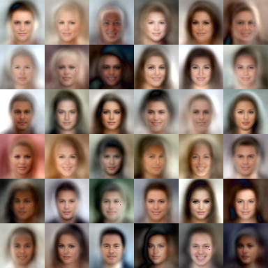
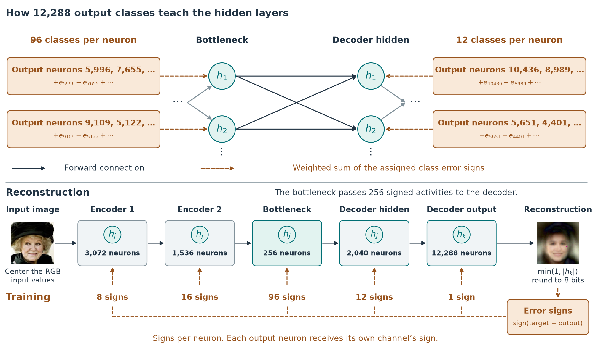
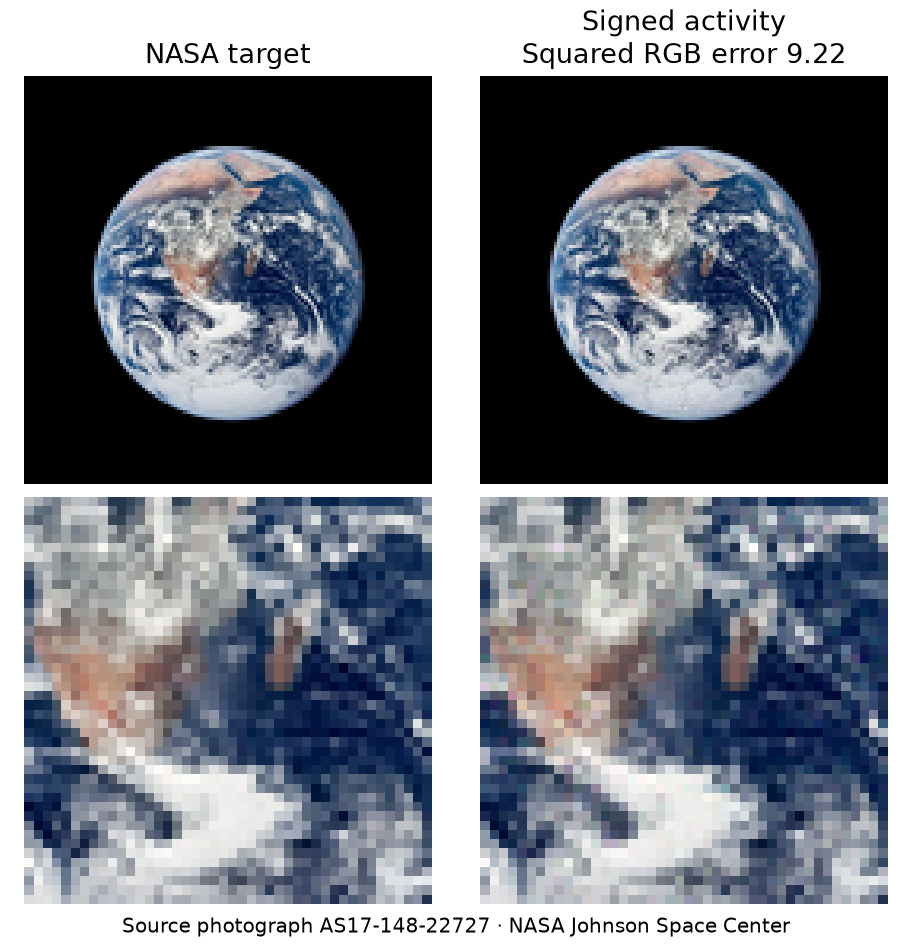
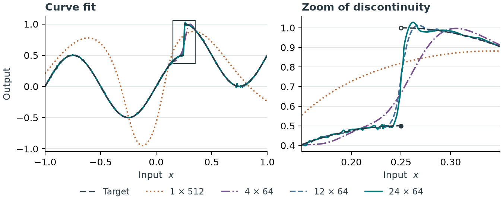
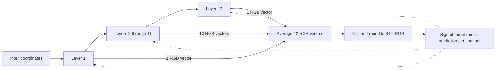

# Hebbian coordinate fitting

[Read the TMLR manuscript (PDF)](papers/main.pdf) · [LaTeX source and reproduction instructions](papers/README.md)

This repository tests dense mixed-class MLPs as black-box regressors. Every hidden layer trains by local signed coactivity. The manuscript coordinate regressors sum signed neuron activities. The CelebA decoder predicts each intensity from the activity magnitude of one output neuron. The project prohibits gradient descent anywhere in training. [Project constraints](AGENTS.md)

## Results

### CelebA face generation

#### 256-value bottleneck

The manuscript's CelebA model scores **171.74** mean summed squared RGB error per image across the 19,962 official test images, with intensities on the [0, 1] scale. Its dense layers are **12,288 → 3,072 → 1,536 → 256 → 2,040 → 12,288**, with **68,469,496** learned weights and biases. Each hidden neuron receives its own group of signed output errors. Each final neuron predicts one RGB channel from its activity magnitude. [Manuscript results and reproduction commands](papers/README.md#celeba)





### NASA Blue Marble

The network maps raw $(x,y)$ coordinates to RGB on the bundled 128 × 128 crop of Apollo 17 frame AS17-148-22727. Each color channel has one competition pool per layer. Every coordinate passes through the same dense network. [NASA Johnson Space Center source photograph](https://science.nasa.gov/resource/the-blue-marble/)

All **16,384** original pixels participate in training and checkpoint selection.


The network maps $(x,y)$ through **12 dense hidden layers of 432 neurons** to three RGB outputs. Each hidden layer has one Gaussian competition pool of 144 neurons per channel. The widths, in layer order, are 0.240, 0.225, 0.211, 0.196, 0.182, 0.167, 0.153, 0.138, 0.124, 0.109, 0.095 and 0.080. The first layer has 1,296 affine parameters and the remaining layers have 187,056 each, for **2,058,912 trainable weights and biases**. Weight initialization uses a zero-mean normal distribution with standard deviation $1/\sqrt{\text{fan-in}}$, and biases use standard deviation 0.35.

For each color, sum the signed activities of its neurons in each layer. Average the 12 estimates, then clip and round to 8-bit RGB. Every hidden layer trains by local Hebbian coactivity using the sign of the final RGB residual. A matching channel supplies a teaching sign of zero.

The Blue Marble fit uses semi-implicit Lion with one 560-epoch cosine starting at 0.004 and batches of 128. Each neuron adjusts its step from the agreement between its latest Hebbian coactivity and its running history. The rule is identical across layers and uses no settings tied to layer depth.

The signed-activity fit reaches **9.22** summed squared RGB error at epoch 560. [Convergence](assets/results/marble-signed-activity-12x432-0.004-b128-e560-mojo.png) · [Per-layer images](papers/figures/earth-layers.pdf) · [Reproduction commands](papers/README.md#blue-marble)



### Sine wave with a jump at the crest

The target is $f(x)=0.5\sin(2\pi x)+0.5\,\mathbf{1}_{x>0.25}$. Its left and right slopes approach zero at the crest, where the value jumps from 0.5 to 1.0. The MLP receives only raw coordinates. Each of the training, validation and test grids contains 4,096 points.

The four signed-activity MLPs train for 640 epochs in batches of 64 with the same Hebbian update as Blue Marble and a cosine starting at 0.00075. For each size, the figure shows the fit with the median test RMSE across three runs. [Measurements and reproduction commands](papers/README.md#discontinuous-sine)



## Network and updates

Every hidden neuron receives every input from the preceding layer. A neuron with $F$ inputs and $K$ coefficients per edge trains $KF+1$ parameters, including its bias. Affine edges use one weight. Continuous two-piece edges use three endpoint heights, and discontinuous edges use four at $-1,0^-,0^+,1$. A piecewise edge linearly interpolates on each side and extrapolates outside the endpoints. Its interpolation coefficients serve as presynaptic activities during training.

With `--connection discontinuous`, the optional `--edge-transitions` setting takes one half-width $w$ per layer. For each incoming activity $u$, set $t=\operatorname{clip}((u/w+1)/2,0,1)$ and $q=t^2(3-2t)$, then combine the two lines $L$ and $R$ as $(1-q)L(u)+qR(u)$. This preserves the original lines outside the band and joins them with a continuous slope. A width of zero uses a sharp switch at zero.



Each neuron applies the selected gate to its preactivation, optionally after applying a sine activation. The hard gate keeps the largest magnitudes with stable index ordering for ties. The Gaussian and tent gates scale every signed activity. Competition can use one pool per class, one pool per output channel containing both of its classes, or one pool for the whole layer. For Gaussian width $\tau$, pool maximum $m>0$ and activation $z$, the multiplier is $\exp[-\min((m-|z|)/(m\tau),13)^2/2]$. An all-zero pool remains zero. The optional `gaussian-smooth` uses $m=\sqrt{\sum_i z_i^{16}/\sum_i z_i^{14}}$ in the same Gaussian. This center varies smoothly when the strongest neuron changes. With `gaussian-dual`, adjacent neurons alternate between $0.75\tau$ and $1.25\tau$, dividing each class evenly between the two widths. All neurons in a competition pool use the same maximum. Tent scaling uses the same relative distance and a floor of 0.01. The ungated option passes each activity through.

For output channel $k$, define $U_k$ and $D_k$ as the sums of the magnitudes in its increase and decrease classes. `--readout class-sum` returns $U_k-D_k$. The default `fixed` divides this difference by the number of neurons per class for a scaled or ungated layer, or by the configured winners per class for a hard gate. `sum` adds the original signed activities in both classes. By default only the final hidden layer contributes. With `--readout-layers all`, these three readouts average the fixed pools from every layer.

The optional `--readout class-energy --readout-layers all` implements the paper's class energy for a dense network. For each output, subtract the decrease-class score from the increase-class score. Each score sums the layers' squared activities divided by the per-class count $K_\ell$. With Gaussian competition, every neuron participates, so $K_\ell$ is the class width. With hard competition, the denominator is the configured winner count per class. All layers' normalized energies are **summed** before any output clipping or rounding. The residual of the resulting signed value supplies the usual teaching sign. [Paper scoring rule](https://arxiv.org/html/2611.24314v1#S2.SS2)

The image command defaults to 256 levels over $[-1,1]$ with clipping enabled. Predictions and targets are rounded at the same spacing, which is $2/255$ in this case. Use `--no-clip-output` to allow predictions beyond the nominal range to supply signed corrections. PNG rendering limits RGB to its display range. Use `--output-levels 0` for continuous values.

For each minibatch, compute the prediction first. In the signed-activity regressors, neuron $j$ assigned to output $k$ receives $s_j=\operatorname{sign}(h_j)\operatorname{sign}(y_k-\hat y_k)$. For samples with nonzero $s_j$ and postsynaptic activity $h_j$, form the local means $A_{ij}=\operatorname{mean}(u_i s_j h_j)$ and $Q_j=\operatorname{mean}(h_j^2)$. The bias input is one. Skip a neuron when it has no contributing samples. The update direction uses this local coactivity statistic.

Both Lion updates use $D_{ij}=\operatorname{sign}(0.125m_{ij}+0.875A_{ij})/\sqrt{KF+1}$, then set $m_{ij}\gets0.99m_{ij}+0.01A_{ij}$. The history starts at zero.

- `--hidden-rule lion` applies the semi-implicit update $w_{ij}\gets(w_{ij}+\eta D_{ij})/(1+\eta Q_j)$.
- `--hidden-rule lion-explicit` applies the explicit update $w_{ij}\gets w_{ij}+\eta D_{ij}-\eta Q_jw_{ij}$ using the old weight in the last term.
- `--hidden-rule lion-adaptive-agreement` applies the semi-implicit update with step $\eta g_j$. Each neuron starts with $g_j=1$. Before updating the history, take the mean $a_j$ of $\operatorname{sign}(A_{ij})\operatorname{sign}(m_{ij})$ over its incoming weights and bias, then set $g_j\gets\operatorname{clip}(g_j\,0.99^{-a_j},\,0.01,\,1)$. Every layer follows the same rule with one shared schedule. NumPy and Mojo implement this variant.

The optional unit-norm update normalizes the receiving neuron's updated weights and bias together. The CLI uses one cosine decay by default. At epoch $e$ of a budget of $T$, the multiplier is $[1+\cos(\pi(e-1)/T)]/2$. It starts at the configured step and decreases from the second epoch onward. Use `--schedule hold-cosine` to hold the step near its starting value for the first fifth of training. With `--layer-rate-decay d`, a hidden layer with $k$ layers after it takes a step of $\eta d^k$. The default $d=1$ gives every layer the same step size. [NumPy model](hebbian_fit/model.py) · [Mojo GPU kernels](hebbian_fit/_hebbian_gpu.mojo)

## Reproduction

The [manuscript reproduction guide](papers/README.md#reproduce-the-figures-and-measurements) gives the training and plotting commands for all three experiments.

Install the CPU dependencies with `uv sync`. Use `uv sync --extra gpu` for Mojo. The GPU kernel build defaults to `sm_120` and was tested on an NVIDIA RTX 5070 Laptop GPU. Set `HEBBIAN_GPU_TARGET` to select another NVIDIA target or `MOJO_BIN` to specify the compiler.

```sh
export OPENBLAS_NUM_THREADS=1
uv run python -m unittest discover -s tests -v
HEBBIAN_TEST_GPU=1 uv run --extra gpu python -m unittest discover -s tests -v
```

The runner supports `sine`, `steps` and `image`. Add `--backend mojo` for GPU execution. For scalar targets, `--samples` sets the number of coordinates per split. For your own image, use `image --image PATH --fit-all-pixels` to train on every pixel and select the checkpoint with the lowest summed squared RGB error. The runner saves the settings, error trace, checkpoint and a reconstruction plot. [Bundled NASA image](assets/blue-marble-128.png)
