# Hebbian coordinate fitting

This repository tests dense mixed-class MLPs as black-box regressors. Every hidden layer trains by local signed coactivity. The output uses fixed class-magnitude differences with zero trainable weights or biases. The project prohibits gradient descent anywhere in training. [Project constraints](AGENTS.md)

## Results

### CelebA face generation


The dense autoencoder with a **2,048-value code** completed one pass over all **162,770 training portraits**. Summed squared RGB error fell from **245.8 to 215.2 per training portrait**, a **12.5% reduction** from the 1,024-value model. On the official 19,962-image test split it fell from **244.9 to 214.6**. Each score sums squared differences across all RGB values on a 0–1 scale, then averages across portraits. [Selected run, architecture, and decoder checksum](assets/results/celeba.json)

Across two blocks of 216 seeds, the selected generator raised the average spread of smoothed grayscale facial edges from **0.676 to 0.730** and lowered the mean gap between generated and held-out brightness quantiles from **0.014 to 0.011**. This edge measure captures some lighting variation along with facial structure. The samples still lean toward front-facing, feminine-looking faces, and some show visible grain. [Width and sampler measurements](assets/results/celeba-width-comparison.json)

#### Matched width and sampler comparisons

| Encoder layer widths | Trainable parameters | Training RGB error | Test RGB error | Training panel facial-edge error |
|---|---:|---:|---:|---:|
| 768 → 1,024 | 35,415,808 | 245.8 | 244.9 | 0.410 |
| 1,536 → 1,024 | 45,640,192 | 251.5 | 250.5 | 0.421 |
| **768 → 2,048** | **61,369,088** | **215.2** | **214.6** | **0.357** |

All three models used seed 7 and the same full-data schedule. On a fixed panel of 2,048 training portraits, the larger code better preserved facial edges associated with eyeglasses and open-mouth smiles. Facial-hair contrast was essentially flat. The local contact sheet shows the same 18 original portraits beside each model's reconstructions, with visible losses in fine detail. [Earlier capacity experiments](assets/results/celeba-capacity.json)

| Sampled directions per component | Facial-edge spread ↑ | Brightness quantile error ↓ | High-frequency chroma ↓ |
|---|---:|---:|---:|
| 20 | 0.683 | 0.008 | 0.066 |
| **64** | **0.730** | **0.011** | **0.077** |
| 128 | 0.778 | 0.007 | 0.084 |

The table averages the two seed blocks with the same decoder, Gaussian components, and scale. The selected 64-direction export increases edge spread while keeping high-frequency chroma close to the previous published generator. The 128-direction export spreads further and shows more color grain. [Matched sample grids](assets/results/celeba-width-sampling.png)

#### Selected architecture

| Stage | Layer sizes | Trainable weights and biases |
|---|---|---:|
| First encoder layer | 12,288 → 768 | 9,437,952 |
| Encoder code layer | 768 → 2,048 | 1,574,912 |
| Image-vector decoder | 2,048 → 24,576 | 50,356,224 |
| Fixed pooling | 24,576 → 12,288 RGB values | 0 |
| **Total** | | **61,369,088** |

The encoder subtracts the same training-set feature mean vector from every flattened portrait. Its first layer has three Gaussian pools of 256 neurons, each with 128 increase and 128 decrease neurons. Its second layer has pools of 684, 684, and 680 neurons containing complete increase/decrease pairs. Both encoder layers use Gaussian width **0.50**. The decoder computes the whole image in one dense pass. Each output scalar has a two-neuron pool of Gaussian width **0.24**, with one increase neuron and one decrease neuron. Fixed pooling subtracts their activity magnitudes, then clips and rounds to 8-bit RGB.

Each minibatch contains 32 portraits. For each output scalar, the quantized target minus the quantized prediction supplies the teaching sign. Matching values supply a zero sign. A fixed random permutation assigns output coordinates to pairs in each encoder layer, with 32 votes per pair in the first layer and 12 in the code layer. Half of a pair's votes carry a positive multiplier and half carry a negative one. The sum of these votes, multiplied by the neuron's class polarity, teaches each neuron through local presynaptic and postsynaptic coactivity. The coactivity and activity-power denominators count all nonzero votes, including those that cancel. All three dense layers train on each minibatch. The decoder step starts at **0.004** and the encoder step starts at **0.0006**. The schedule holds them for the first fifth of the run and then decays them to zero with a cosine. The training error on a fixed 512-portrait panel selects the checkpoint. [Local update equations](#network-and-updates)

The decoder export uses **16 Gaussian components** computed from the training codes. Grouping uses the eight leading standardized code directions. Each component retains its 64 largest covariance directions and scales their standard deviations by **0.85**. A seed chooses a component by training frequency and draws a fresh code for the decoder.

Use a local ZIP of the aligned CelebA JPEGs and pass `--partitions` if the official split list is separate. [CelebA data and research terms](https://mmlab.ie.cuhk.edu.hk/projects/CelebA.html)

```bash
python -m experiments.celeba /path/to/celeba.zip --backend mojo --full-only \
  --full-epochs 1 --select-on-training --output runs/celeba-capacity/fixed768x2048 \
  --decoder vector --encoder-width 768 --latent-width 2048 \
  --encoder-gate-widths .5 .5 --projected-encoder-votes --center-encoder --encoder-rate .15
python -m experiments.celeba_prior runs/celeba-capacity/fixed768x2048/full \
  --components 16 --local-scale .85 --local-rank 64 \
  --output runs/celeba-capacity/fixed768x2048/full/decoder-mixture.npz
python -m hebbian_fit.autoencoder runs/celeba-capacity/fixed768x2048/full/decoder-mixture.npz \
  --seed 42 --output face.png
```

### NASA Blue Marble

The network maps raw $(x,y)$ coordinates to RGB on the bundled 128 × 128 crop of Apollo 17 frame AS17-148-22727. Each color channel has an increase class and a decrease class. Every coordinate passes through the same dense network. [NASA Johnson Space Center source photograph](https://science.nasa.gov/resource/the-blue-marble/)

#### Final all-pixel fit

The final reconstruction reaches **47.17 summed squared RGB error**. All **16,384** original pixels participate in training and checkpoint selection. The model uses initialization seed 5. The enlarged crop shows the remaining differences in fine cloud texture and coastlines. [Training settings and per-epoch error](assets/results/blue-marble-output-depth-12-two-phase-all-pixels.json)

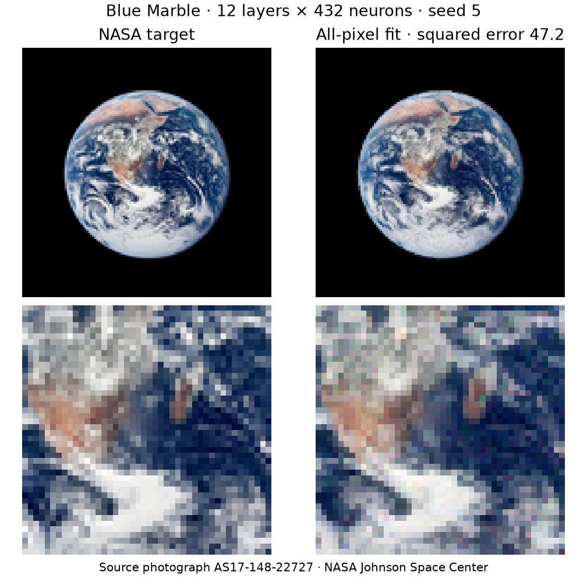

The network maps $(x,y)$ through **12 dense hidden layers of 432 neurons** to three RGB outputs. Each hidden layer contains 72 increase and 72 decrease neurons per channel. Each channel's two classes share one Gaussian competition pool. The widths, in layer order, are 0.240, 0.225, 0.211, 0.196, 0.182, 0.167, 0.153, 0.138, 0.124, 0.109, 0.095 and 0.080. The first layer has 1,296 affine parameters and the remaining layers have 187,056 each, for **2,058,912 trainable weights and biases**. Weight initialization uses a zero-mean normal distribution with standard deviation $1/\sqrt{\text{fan-in}}$, and biases use standard deviation 0.35.

For each color, the fixed readout subtracts the decrease-class magnitude sum from the increase-class magnitude sum in each layer. It averages those 12 signed values, then clips and rounds to 8-bit RGB. Every hidden layer trains by local Hebbian coactivity using the sign of the final RGB residual. A matching channel supplies a teaching sign of zero.

| Training phase | Rule | Epochs | Batch size | Initial step |
|---|---|---:|---:|---|
| 1 | Memoryless signed coactivity | 80 | 128 | 0.004 across layers |
| 2 | Lion-style coactivity | 480 | 64 | 0.0015 in the final layer, multiplied by 0.7 per layer going backward |

Each phase holds its starting step for roughly one fifth of its budget, then decays it on a cosine schedule. Phase two loads the lowest-error checkpoint from phase one and starts its coactivity history at zero. Both phases selected their last epoch. [Exact local update equations](#network-and-updates)

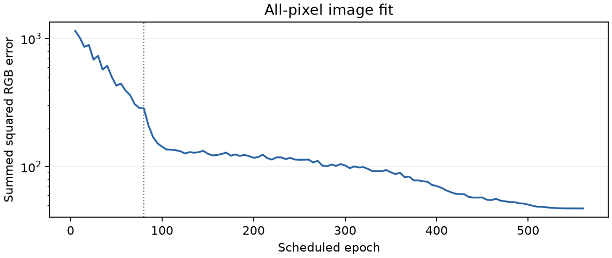

#### What each layer contributes

The first grid averages the raw RGB readouts from layers 1 through the indicated layer, then clips and rounds once. The early layers establish the outline and broad colors. Later layers add cloud and coastal detail. In this checkpoint, error falls with each added layer, from **7,194.38** with layer 1 to **91.04** with layers 1–11 and **47.17** with all 12.

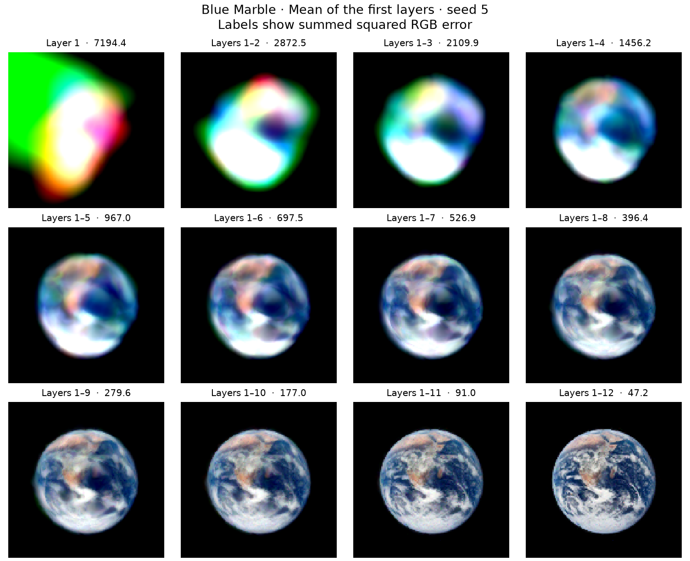

The second grid shows the RGB readout of each layer in isolation. Every tile uses the same trained network. Each layer receives the activations of the preceding layers. The deep readouts show fine structure and strong color casts. Combining them brings the colors into balance. Layer 9 has the lowest individual error at **2,836.10**.

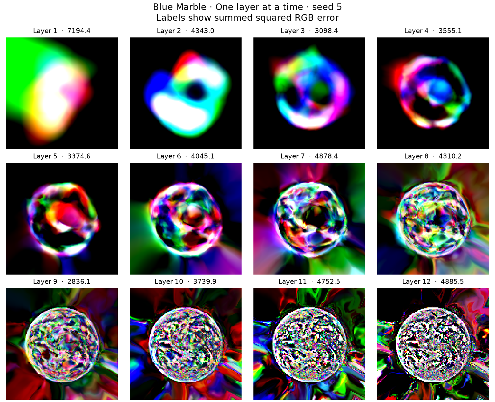

<details>
<summary>Between-pixel diagnostic</summary>

At each of the 16,129 centers between four adjacent pixels, we compared the model's prediction with the mean of the four surrounding RGB values. This is bilinear interpolation at the center. The cumulative readout reached **71.68** squared error through layer 11 and **97.62** through layer 12 against that reference. The final fit uses only the original pixel colors to learn and choose its checkpoint. [Per-layer measurements](assets/results/blue-marble-output-depth-12-two-phase-all-pixels.json)

</details>

### Scalar regression

Training examples are evenly spaced $(x,f(x))$ pairs on $[-1,1]$, shuffled each epoch. Validation and test use separate, interleaved coordinates. Compared with the earlier study, the sine uses eight times as many training examples and the staircase uses four times as many. Each of the 64 finest plateaus contains exactly 32 training examples.

| Target | Training examples | Dense architecture | Trainable parameters | Median test RMSE |
|---|---:|---|---:|---:|
| Sine | 4,096 | 1 → 6 layers of 96 → 1 | 46,752 | **0.01147** |
| Staircase and smooth region | 12,288 | 1 → 12 layers of 96 → 1 | 102,624 | **0.28890** |

Both winning fits use affine connections and fixed increase-minus-decrease magnitude pooling averaged across all hidden layers. They use 48 neurons per class per layer. Model settings were selected on validation seeds 1–3 and test results are medians across seeds 7–9. Each figure shows the middle-scoring test run. RMSE is root mean squared error.

The sine uses the smooth Gaussian center with widths 0.320, 0.288, 0.256, 0.224, 0.192 and 0.160. Its test error fell from 0.0300 in the earlier study to 0.01147. In a matched four-layer comparison, smoothing the Gaussian center lowered median validation value error from **0.01781 to 0.01039** and slope error from **0.6758 to 0.5404**. Slope error compares the change in predicted and target values between successive coordinates. The zoom shows the remaining offset around the positive peak. [Sine settings and per-seed results](assets/results/scalar-quality-sine.json)

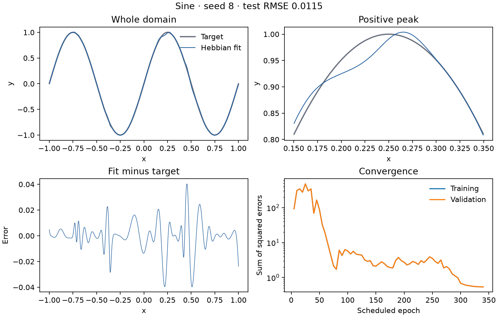

The initial dense staircase fit uses the maximum-centered Gaussian with 12 evenly spaced widths from 0.240 to 0.080 in layer order, rounded to three decimals. The smooth half improved from 0.0872 to **0.03900** RMSE. The overall error is close to the earlier 0.2896. The coarse, intermediate and finest staircase sections reach **0.1260**, **0.3819** and **0.5778**, respectively. The plot shows why the finest steps remain the limiting case. Their rapid alternation is largely missed even with denser sampling. [Staircase settings and per-seed results](assets/results/scalar-quality-steps.json)

[Initial staircase fit and convergence](assets/results/scalar-quality-steps.png)

| Target | Batch | Memoryless phase | First Lion phase | Second Lion phase |
|---|---:|---|---|---|
| Sine | 64 | 80 epochs at initial step 0.003 | 100 epochs at 0.0008, with 0.75 per earlier layer | 160 epochs at 0.0004, with 0.85 per earlier layer |
| Staircase | 128 | 80 epochs at initial step 0.003 | 120 epochs at 0.0015, with 0.8 per earlier layer | 160 epochs at 0.0008, with 0.85 per earlier layer |

The table gives epoch budgets and the initial step in the final layer. Each phase uses the hold and cosine schedule, then keeps its lowest-error validation checkpoint, including its starting weights.

#### Staircase smoothness by layer

The quieter fit uses the same **12 dense hidden layers of 96 neurons** and the same 12,288 training coordinates. Whole-layer Gaussian widths taper from **0.240 to 0.140**, compared with 0.240 to 0.080 in the initial fit. It uses the first two staircase phases above and a 140-epoch final Lion phase at initial step 0.0005, with each earlier layer taking 85% of the next layer's step. The script screens on one initialization, confirms the three lowest-error candidates with lower ripple and slope error on seeds 1–3, and tests the selected fit on seeds 7–9.

| Median test measurement | Initial fit | Quieter fit |
|---|---:|---:|
| Ripple within coarse and intermediate plateaus | 0.08219 | **0.06379** |
| Slope error on the smooth half | 23.37 | **10.19** |
| Value error on the smooth half | 0.03900 | **0.02734** |
| Value error across the full domain | **0.28890** | 0.29440 |
| Value error on the 64 finest steps | 0.57779 | **0.57185** |

Value and slope errors are root mean squared errors. Plateau ripple measures how much predictions vary around their own mean within the central 75% of each coarse or intermediate plateau. The finest steps remain largely unresolved. [Settings, test runs and per-layer measurements](assets/results/staircase-smoothness.json)

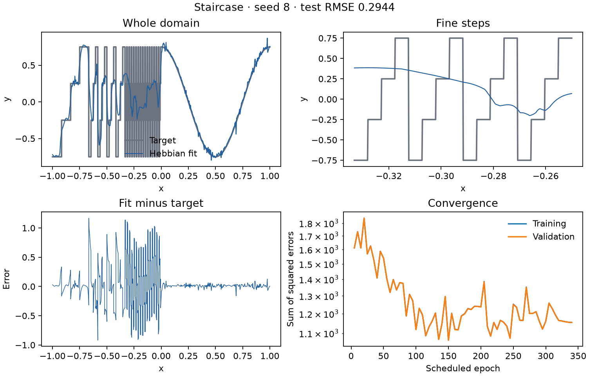

The cumulative grid averages the readouts from layers 1 through the indicated layer. The last panel reproduces the full prediction. The individual grid shows the readout of one layer at a time, with that layer still receiving the activations from all preceding layers. All panels use the same trained checkpoint.

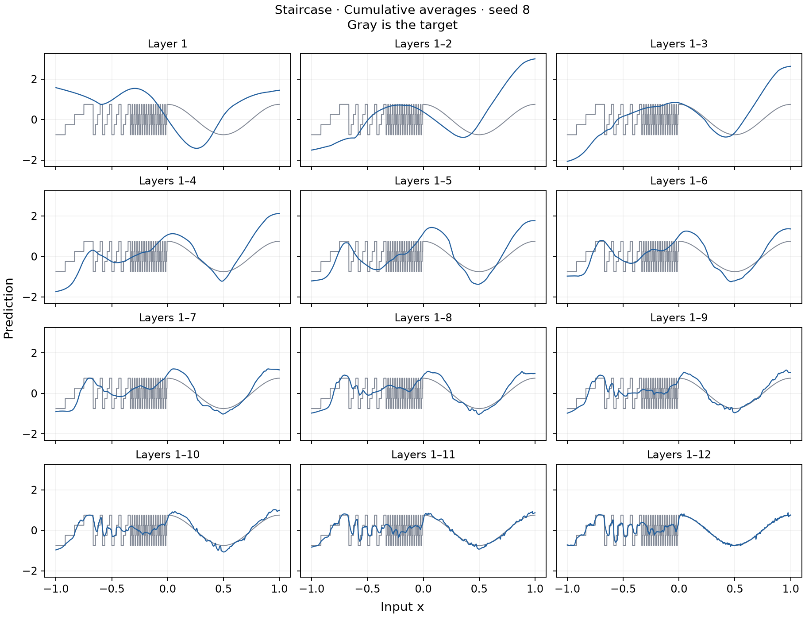

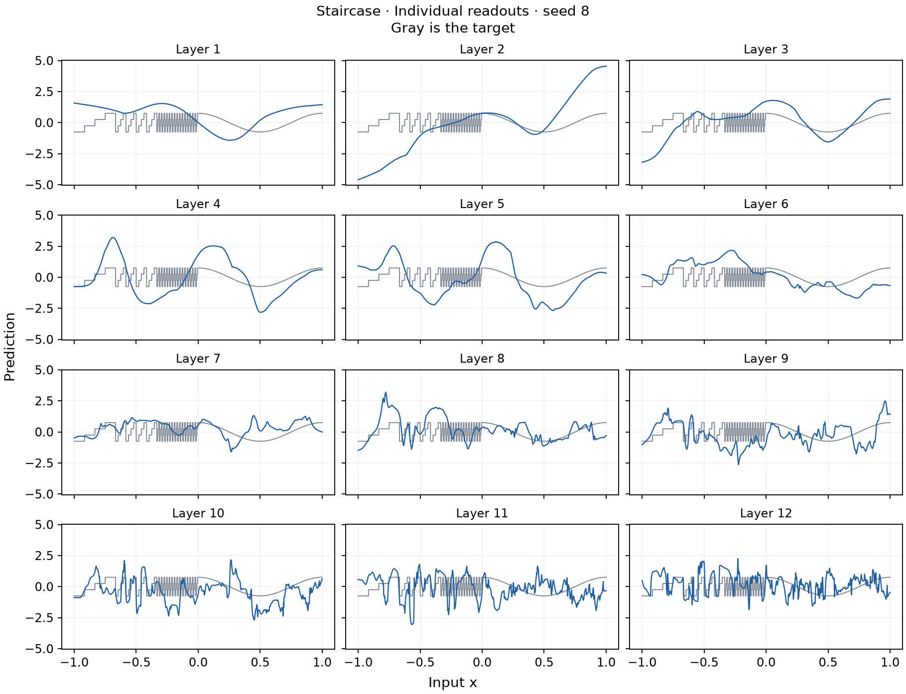

| Layer | Slope error from that layer alone | Slope error averaged through that layer | Value error averaged through that layer |
|---:|---:|---:|---:|
| 1 | 4.59 | 4.59 | 1.2280 |
| 4 | 8.06 | 2.90 | 0.6701 |
| 8 | 26.19 | 4.38 | 0.4391 |
| 12 | 126.84 | 10.19 | 0.2944 |

Later layers improve the cumulative value fit and introduce sharper local variation. Averaging cancels much of that variation. The average through layer 12 fits the target more closely than the average through layer 4, while the average through layer 4 has the smoother slope.

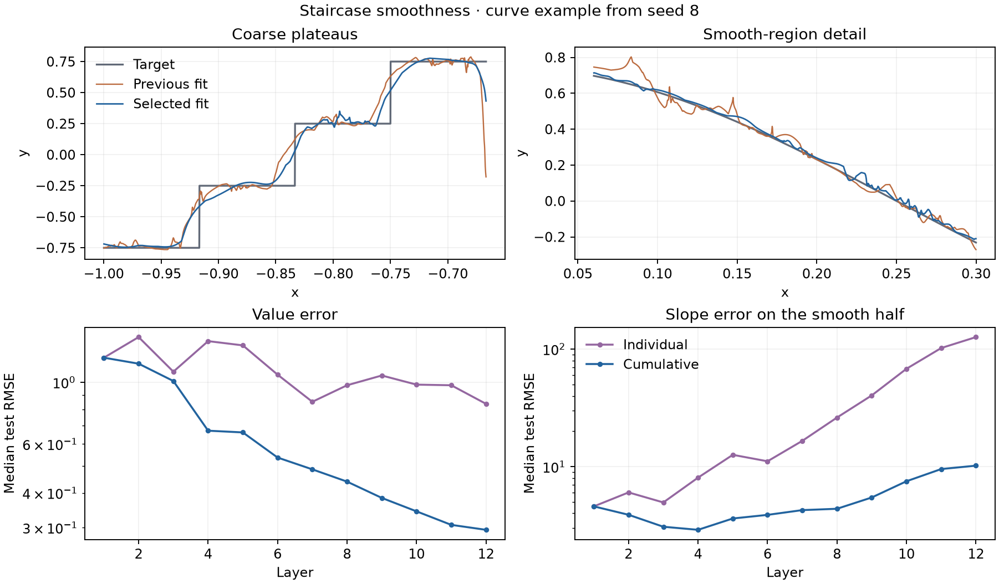

#### Staircase width comparison

Each model has 12 fully connected hidden layers. The single-width runs share the same Gaussian width schedule, initialization procedure, minibatch schedule, fixed layer average, and 12,288 training coordinates. The two-width run uses 96 neurons per layer and splits each class evenly between 0.75 and 1.25 times the scheduled Gaussian width. All neurons in a pool share its maximum. Numbers are medians on the held-out grid for seeds 7–9.

| Neurons per layer | Parameters | Overall RMSE | Finest-step RMSE | Plateau ripple | Smooth-half slope error |
|---|---:|---:|---:|---:|---:|
| 96 | 102,624 | 0.2944 | 0.5718 | **0.0638** | 10.19 |
| 128 | 181,888 | 0.2877 | 0.5782 | 0.0818 | **8.20** |
| 192 | 408,000 | **0.2875** | 0.5716 | 0.0854 | 12.81 |
| 96, two widths | 102,624 | 0.2896 | **0.5694** | 0.0742 | 12.19 |

At 128 neurons, the overall fit and the smooth-half slope improved. The 192-neuron model reached almost the same overall error with more than twice as many parameters and higher ripple. The two-width model improved the finest-step score slightly, and the zoom still shows that it misses most of the alternating step levels. [Settings, checkpoints and per-seed measurements](assets/results/staircase-width.json)

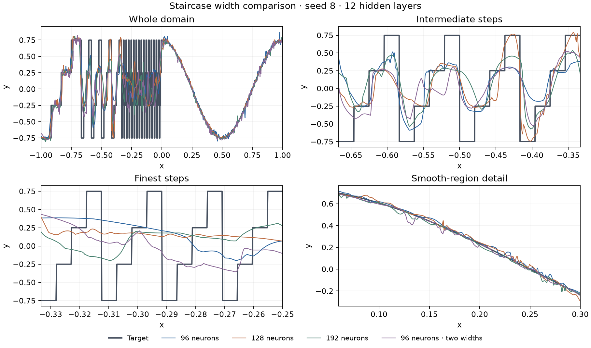

#### 24-layer staircase experiment

This single-seed GPU run uses the same 96 neurons per layer, 12,288 training points, fixed layer average, and phase budgets as the 12-layer reference. The Gaussian widths taper from 0.240 to 0.140 across 24 layers. The two checkpoints shown use initialization seed 8.

| Hidden layers | Parameters | Overall RMSE | Finest-step RMSE | Smooth-half slope error |
|---:|---:|---:|---:|---:|
| 12 | 102,624 | 0.2944 | 0.5874 | **11.66** |
| 24 | 214,368 | **0.2783** | **0.5373** | 83.26 |

The 24-layer curve picks up more of the small-step variation, while the smooth half shows pronounced spikes. The finest-step zoom shows rounded and misplaced transitions. [Settings, selected epochs and test measurements](assets/results/staircase-depth-24.json)

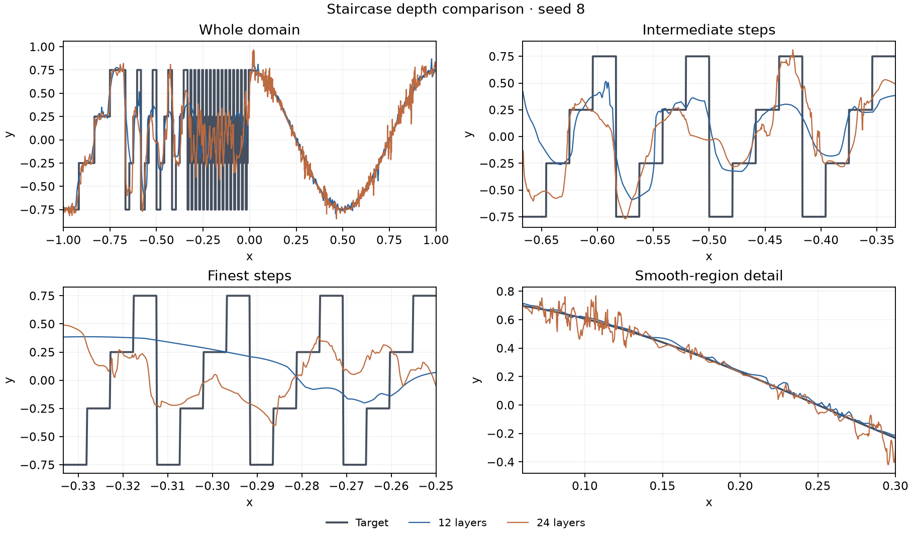

## Network and updates

For each output channel the network assigns one increase class and one decrease class. Scalar regression has two classes and RGB has six. Every hidden neuron receives every input from the preceding layer. A neuron with $F$ inputs and $K$ coefficients per edge trains $KF+1$ parameters, including its bias. Affine edges use one weight. Continuous two-piece edges use three endpoint heights, and discontinuous edges use four at $-1,0^-,0^+,1$. A piecewise edge linearly interpolates on each side and extrapolates outside the endpoints. Its interpolation coefficients serve as presynaptic activities during training.

With `--connection discontinuous`, the optional `--edge-transitions` setting takes one half-width $w$ per layer. For each incoming activity $u$, set $t=\operatorname{clip}((u/w+1)/2,0,1)$ and $q=t^2(3-2t)$, then combine the two lines $L$ and $R$ as $(1-q)L(u)+qR(u)$. This preserves the original lines outside the band and joins them with a continuous slope. A width of zero uses a sharp switch at zero.

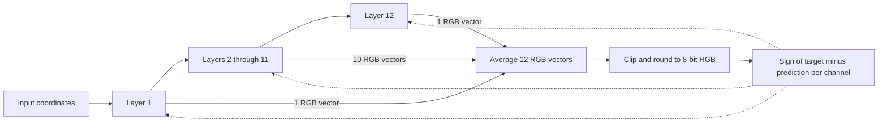

Each neuron applies the selected gate to its preactivation, optionally after applying a sine activation. The hard gate keeps the largest magnitudes with stable index ordering for ties. The Gaussian and tent gates scale every signed activity. Competition can use one pool per class, one pool per output channel containing both of its classes, or one pool for the whole layer. For Gaussian width $\tau$, pool maximum $m>0$ and activation $z$, the multiplier is $\exp[-\min((m-|z|)/(m\tau),13)^2/2]$. An all-zero pool remains zero. The optional `gaussian-smooth` uses $m=\sqrt{\sum_i z_i^{16}/\sum_i z_i^{14}}$ in the same Gaussian. This center varies smoothly when the strongest neuron changes. With `gaussian-dual`, adjacent neurons alternate between $0.75\tau$ and $1.25\tau$, dividing each class evenly between the two widths. All neurons in a competition pool use the same maximum. Tent scaling uses the same relative distance and a floor of 0.01. The ungated option passes each activity through.

For output channel $k$, define $U_k$ and $D_k$ as the sums of the magnitudes in its increase and decrease classes. `--readout class-sum` returns $U_k-D_k$. The default `fixed` divides this difference by the number of neurons per class for a scaled or ungated layer, or by the configured winners per class for a hard gate. `sum` adds the original signed activities in both classes. By default only the final hidden layer contributes. With `--readout-layers all`, these three readouts average the fixed pools from every layer.

The optional `--readout class-energy --readout-layers all` implements the paper's class energy for a dense network. For each output, subtract the decrease-class score from the increase-class score. Each score sums the layers' squared activities divided by the per-class count $K_\ell$. With Gaussian competition, every neuron participates, so $K_\ell$ is the class width. With hard competition, the denominator is the configured winner count per class. All layers' normalized energies are **summed** before any output clipping or rounding. The residual of the resulting signed value supplies the usual teaching sign. [Paper scoring rule](https://arxiv.org/html/2611.24314v1#S2.SS2)

The image command defaults to 256 levels over $[-1,1]$ with clipping enabled. Predictions and targets are rounded at the same spacing, which is $2/255$ in this case. Use `--no-clip-output` to allow predictions beyond the nominal range to supply signed corrections. PNG rendering limits RGB to its display range. Use `--output-levels 0` for continuous values.

For each minibatch, compute the prediction first. Hidden neuron $j$ receives $s_j=\sigma_j\operatorname{sign}(y_k-\hat y_k)$, where $\sigma_j$ is its class polarity. For samples with nonzero $s_j$ and postsynaptic activity $h_j$, form the local means $A_{ij}=\operatorname{mean}(u_i s_j h_j)$ and $Q_j=\operatorname{mean}(h_j^2)$. The bias input is one. Skip a neuron when it has no contributing samples. The update direction uses this local coactivity statistic.

- `--hidden-rule signsgd` uses $D_{ij}=\operatorname{sign}(A_{ij})/\sqrt{KF+1}$ and stores no optimizer history.
- `--hidden-rule lion` uses $D_{ij}=\operatorname{sign}(0.125m_{ij}+0.875A_{ij})/\sqrt{KF+1}$, then sets $m_{ij}\gets0.99m_{ij}+0.01A_{ij}$. The history starts at zero.
- `--hidden-rule activity-sign` multiplies the signSGD direction by $\sqrt{Q_j/(1+Q_j)}$. Low-activity neurons take smaller steps using their own postsynaptic activity. The rule stores no optimizer history.

All three rules update each hidden coefficient by $w_{ij}\gets(w_{ij}+\eta D_{ij})/(1+\eta Q_j)$. The optional unit-norm update normalizes the receiving neuron's updated weights and bias together. The CLI uses one cosine decay by default. At epoch $e$ of a budget of $T$, the multiplier is $[1+\cos(\pi(e-1)/T)]/2$. It starts at the configured step and decreases from the second epoch onward. Use `--schedule hold-cosine` for the earlier schedule that holds the step near its starting value for the first fifth of training. With `--layer-rate-decay d`, a hidden layer with $k$ layers after it takes a step of $\eta d^k$. The default $d=1$ gives every layer the same step size. [NumPy model](hebbian_fit/model.py) · [Mojo GPU kernels](hebbian_fit/_hebbian_gpu.mojo)

## Reproduction

Install the CPU dependencies with `uv sync`. Use `uv sync --extra gpu` for Mojo. The GPU kernel build defaults to `sm_120` and was tested on an NVIDIA RTX 5070 Laptop GPU. Set `HEBBIAN_GPU_TARGET` to select another NVIDIA target or `MOJO_BIN` to specify the compiler.

```sh
export OPENBLAS_NUM_THREADS=1
uv run --extra gpu python -m experiments.blue_marble_quality \
  --backend mojo --capacity --extend --fit-all-pixels output-depth-12-two-phase
uv run --extra gpu python -m experiments.scalar_quality sine --backend mojo --smooth-peak
uv run --extra gpu python -m experiments.scalar_quality steps --backend mojo
uv run --extra gpu python -m experiments.staircase_smoothness --backend mojo
uv run --extra gpu python -m experiments.staircase_width --backend mojo --include-dual
uv run --extra gpu python -m experiments.staircase_width --backend mojo --depth-24
uv run python -m unittest discover -s tests -v
HEBBIAN_TEST_GPU=1 uv run --extra gpu python -m unittest discover -s tests -v
```

The runner supports `sine`, `steps` and `image`. Add `--backend mojo` for GPU execution. For scalar targets, `--samples` sets the number of coordinates per split. For your own image, use `image --image PATH --fit-all-pixels` to train on every pixel and select the checkpoint with the lowest summed squared RGB error. The runner saves the settings, error trace, checkpoint and a reconstruction plot. [Bundled NASA image](assets/blue-marble-128.png)
