# Supervised Hebbian Class Networks: Regression Without Backpropagation

[Read the paper (PDF)](main.pdf) · [LaTeX source](main.tex) · [Bibliography](references.bib)

This paper extends John Loverich’s supervised Hebbian classifier to regression. It retains joint, local Hebbian training and assigns an increase class and a decrease class to each continuous output. [Original paper, *Supervised Hebbian Class Networks: Learning Without Backpropagation*](https://arxiv.org/abs/2611.24314)

The manuscript reports four network sizes on one discontinuous sine target, the all-pixel Blue Marble reconstruction, and the sequential CelebA autoencoder with a 256-value bottleneck. The image panel and reconstruction score use the checkpoint chosen on the official validation split.

## Build the paper

The figures are included. From this directory, run `tectonic main.tex` or `latexmk -pdf main.tex`. Either produces `main.pdf` without training a model or obtaining CelebA. The manuscript uses the TMLR template's preprint format. The bundled style and bibliography files come from the official template at revision `7bf90efe`. [TMLR template](https://github.com/JmlrOrg/tmlr-style-file/tree/7bf90efe3a0debbba703c05c43f3ff7e4d4a2992) · [Template license](TMLR-LICENSE)

## Reproduce the figures and measurements

Run the following commands in Bash **from the repository root**. The scalar fits and the diagram scripts use NumPy and Matplotlib. The coordinate fits use NumPy. The image training runs use the Mojo backend on an NVIDIA RTX 5070 Laptop GPU. Use Python 3.12 or later and the project dependencies. Set `HEBBIAN_GPU_TARGET` to the target of your GPU if it differs from the default `sm_120`.

```bash
uv sync --extra gpu
source .venv/bin/activate
export OPENBLAS_NUM_THREADS=1
python -m papers.diagrams
```

For just the diagrams and the sine fits, `uv sync` installs the CPU dependencies. The diagrams are editable vector figures. [Blue Marble network diagram](figures/implicit-image.pdf) · [CelebA autoencoder diagram](figures/autoencoder.pdf) · [Hidden-pair feedback diagram](figures/pixel-votes.pdf) · [Diagram source](diagrams.py) · [Figure and measurement code](results.py)

### Discontinuous sine

The dataset is generated from $0.5\sin(2\pi x)+0.5\,\mathbf{1}_{x>0.25}$ on $[-1,1]$. There is no external download. [Target definition](../experiments/sine_jump.py) · [Grid and splits](../hebbian_fit/data.py)

```bash
OPENBLAS_NUM_THREADS=1 python -m papers.lion sine --rule lion-adaptive-agreement --workers 4
python -m papers.results sine
```

The first command trains the four configurations or loads completed runs from `runs/scalar-quality`. Each run uses 640 epochs, batches of 64 and one cosine starting at 0.00075. Each split contains 4,096 distinct points in the training interval. The second command renders the paper figure. [Measurements](../assets/results/sine-jump-fit-cosine-all-lion-adaptive-agreement.json) · [Paper figure](figures/sine.pdf)

### Blue Marble

The exact input is the bundled 128 × 128 RGB crop of Apollo 17 frame AS17-148-22727. The loader scales its pixel coordinates and channel values to $[-1,1]$. Use the bundled PNG to match the paper. [Input image](../assets/blue-marble-128.png) · [NASA source photograph](https://science.nasa.gov/resource/the-blue-marble/)

```bash
OPENBLAS_NUM_THREADS=2 python -m experiments.blue_marble_shared_step --rule lion-adaptive-agreement --rate .004 --until 560 --fits
OPENBLAS_NUM_THREADS=2 python -m papers.results marble
```

The first command trains on all 16,384 pixel centers for 560 epochs with batches of 128 and one cosine. It reports the sum of squared RGB differences in units of $[0,1]$. The second command loads the selected checkpoint and renders both paper figures. The accumulated contribution through layer 12 equals the full prediction after clipping and rounding. Pass `--checkpoint` to use another checkpoint with the same configuration. [Photograph and fit](figures/earth.pdf) · [Individual layers and accumulated contributions](figures/earth-layers.pdf) · [Measurements](../assets/results/blue-marble-shared-step-lion-adaptive-agreement-0.004.json)

### CelebA

Obtain the aligned CelebA JPEG archive and official evaluation partition list from the dataset authors. The loader accepts a ZIP of aligned JPEGs and their original filenames. If the list is already inside the ZIP, omit the `--partitions` argument. The loader center-crops each photograph to a square and resizes it to 64 × 64 RGB. [Dataset, partitions and terms of use](https://mmlab.ie.cuhk.edu.hk/projects/CelebA.html) · [Training and preprocessing](../experiments/celeba.py)

```bash
face_archive=/path/to/img_align_celeba.zip
face_partitions=/path/to/list_eval_partition.txt
run=runs/celeba-sequential/full/code256-balanced-lite-long

portrait_args=("$face_archive" --partitions "$face_partitions" --backend mojo --reconstruction-only
  --decoder vector --encoder-width 3072 --encoder-hidden-widths 1536 --latent-width 256
  --encoder-top-k 768 86 --encoder-gate-widths .85 .85 --vector-hidden-width 256
  --projected-encoder-votes --projected-decoder-votes --center-encoder --decoder-init-scale .12
  --vector-gate-width .44 --images-per-batch 128 --rate .0008)

OPENBLAS_NUM_THREADS=2 python -m experiments.celeba "${portrait_args[@]}" \
  --full-only --full-epochs 2 --checks-per-epoch 2 --output "$run" \
  --rule lion --encoder-rate .15 --decoder-rate-decay .15

python -m papers.results reconstruction --run "$run/full" --vector-gate-width .40
OPENBLAS_NUM_THREADS=4 python -m experiments.celeba_prior "$run/full" --vector-gate-width .40 \
  --components 16 --local-rank 64 --local-scale .85 --output "$run/full/decoder-mixture-selected.npz"
python -m papers.results portraits --run "$run/full"
```

The autoencoder diagram uses the first test image and its semi-implicit Lion reconstruction from the first two rows of the comparison sheet. The bundled comparison sheet and the CPU diagram command above reproduce the figure. [Reconstruction sheet](../assets/results/celeba-256-lion-explicit-reconstructions.png)

The model maps 12,288 input values through layers of 3,072 and 1,536 neurons to a 256-value embedding. The decoder uses a 1,536-neuron hidden layer and 24,576 output neurons arranged in 12,288 increase/decrease pairs. There are 81,033,472 learned weights and biases.

Training makes two passes over all 162,770 training images with one Lion update throughout. A single schedule holds the starting step for the first fifth of all minibatches and decays it to zero along a half cosine. The checkpoint is selected on 512 official validation images. With the selected weights, validation chose an RGB Gaussian width of 0.40, giving **184.19** mean summed squared RGB error on the 19,962 official test images. The sampler fits the selected encoder's embeddings for all training images. An existing mixture export is sufficient to draw the 36 images. [Run settings and measurements](../assets/results/celeba-256.json) · [Sampler](../experiments/celeba_prior.py) · [Paper image panel](figures/portraits.png)

To compare updates on a smaller training sample, reuse `portrait_args`. All runs use the same 8,192 images from the official training split and the same 512 validation images. They train for two passes in batches of 128. The two ordinary Lion runs use the paper's layer timesteps and one shared timestep, respectively. Adaptive Lion starts from the shared timestep and adjusts it for each neuron.

```bash
pilot=("${portrait_args[@]}" --pilot-only --pilot-images 8192 --epochs 2 --checks-per-epoch 4)
OPENBLAS_NUM_THREADS=2 python -m experiments.celeba "${pilot[@]}" \
  --rule lion --encoder-rate .15 --decoder-rate-decay .15 \
  --output runs/celeba-sequential/screen/code256-shared-step-control
OPENBLAS_NUM_THREADS=2 python -m experiments.celeba "${pilot[@]}" \
  --rule lion \
  --output runs/celeba-sequential/screen/code256-shared-step-uniform
OPENBLAS_NUM_THREADS=2 python -m experiments.celeba "${pilot[@]}" \
  --rule lion-adaptive-agreement \
  --output runs/celeba-sequential/screen/code256-shared-step-agreement
```

| CelebA pilot update | Mean validation squared RGB error after two passes |
| --- | ---: |
| Ordinary Lion with the paper's layer timesteps | 470.71 |
| Ordinary Lion with one shared timestep | **445.16** |
| Adaptive Lion with one shared timestep | 445.54 |

A shared timestep reduced the pilot's validation error by about 5.4%. The two shared-step runs finished within 0.39 squared RGB error per image. The final mean adaptive multipliers across the five layers ranged from 0.9972 to 0.9997. The paper's image panel uses the full-data run described above. [Pilot settings, measurements and curves](../assets/results/celeba-256-shared-step.json)

#### One neuron per RGB output

For each RGB output, the decoder predicts `min(1, |h|)` on the [0, 1] intensity scale, with `h` the signed activity of a single neuron. The sign of the difference between target and prediction teaches that neuron to reinforce or suppress its activity. The hidden layers still use the signed votes from the reconstruction to teach increase/decrease pairs. The output layer has 12,288 neurons and the total falls from 81,033,472 to 62,146,816 learned weights and biases.

Both models use the 256-value bottleneck, semi-implicit Lion and the two-pass CelebA training schedule above. The single-neuron model scored **190.48** mean summed squared RGB error on all 19,962 official test images. The paired model scored **185.38** with its training settings and **184.19** with its validation-selected inference width. The single-neuron rule reduced the parameter count by 23.3%. [Measurements](../assets/results/celeba-single-output.json) · [Validation curves](../assets/results/celeba-single-output.png)

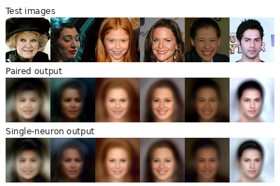

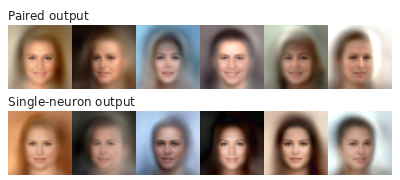

Reuse `portrait_args` above and add `--single-output-neuron`. The single-neuron output uses magnitude pooling directly, so its output layer has no Gaussian competition.

```bash
OPENBLAS_NUM_THREADS=2 python -m experiments.celeba "${portrait_args[@]}" \
  --full-only --full-epochs 2 --checks-per-epoch 2 --output runs/celeba-single-output \
  --rule lion --encoder-rate .15 --decoder-rate-decay .15 --single-output-neuron

OPENBLAS_NUM_THREADS=4 python -m experiments.celeba_prior runs/celeba-single-output/full \
  --components 16 --local-rank 64 --local-scale .85 \
  --output runs/celeba-single-output/full/decoder-mixture-selected.npz
```

##### Tuning the single-output model

All runs train from initialization on the full CelebA training split with batches of 128, a 256-value bottleneck and one neuron per RGB output. Each uses semi-implicit Lion with one cosine schedule and selects a checkpoint on the same 512 validation images. The tuning trials vary the training budget, the starting steps for the encoder, decoder hidden layers and RGB output, and the width and depth of the decoder.

| Run | Passes completed | Selected pass | Weights and biases | Test error per image ↓ |
| --- | ---: | ---: | ---: | ---: |
| Two-pass single-output baseline | 2 | 2 | 62,146,816 | 190.48 |
| Four passes with the original steps | 4 | 1.5 | 62,146,816 | 192.69 |
| Larger decoder hidden step | 2.5 | 1 | 62,146,816 | 195.59 |
| Added decoder hidden layer | 2 | 1.5 | 64,507,648 | 217.60 |
| Smaller RGB output step | 2 | 1.5 | 62,146,816 | 204.65 |
| Wider decoder hidden layer | 2 | 2 | 68,469,496 | 184.15 |
| Smaller hidden steps | 3 | 3 | 62,146,816 | 178.59 |
| Wider decoder and smaller hidden steps | 3 | 3 | 68,469,496 | **172.41** |

Test error is the mean sum of squared RGB differences per image across all 19,962 official test images. The lowest validation error came from widening the decoder hidden layer from 1,536 to 2,040 neurons and reducing the encoder and decoder hidden starting steps from 0.00012 to 0.00008. The RGB output starts at 0.0008. This reduces test error by 9.5% from the single-output baseline. The original-width model with smaller hidden steps reaches 178.59 with the same parameter count as the baseline. [Run settings and measurements](../assets/results/celeba-single-output-tuning.json) · [Validation curves](../assets/results/celeba-single-output-tuning.png)

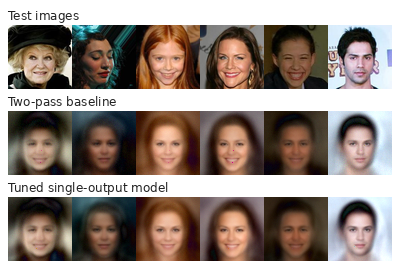

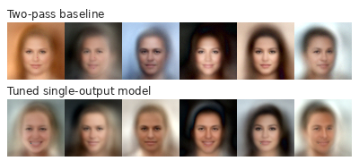

```bash
single_args=("${portrait_args[@]}" --rule lion --single-output-neuron
  --full-only --checks-per-epoch 2 --encoder-rate .15)

OPENBLAS_NUM_THREADS=2 python -m experiments.celeba "${single_args[@]}" \
  --full-epochs 4 --decoder-rate-decay .15 \
  --output runs/celeba-single-output-tuning/four-pass
OPENBLAS_NUM_THREADS=2 python -m experiments.celeba "${single_args[@]}" \
  --full-epochs 4 --decoder-rate-decay .30 \
  --output runs/celeba-single-output-tuning/decoder-step-030
OPENBLAS_NUM_THREADS=2 python -m experiments.celeba "${single_args[@]}" \
  --full-epochs 3 --decoder-rate-decay .15 --vector-hidden-depth 2 \
  --output runs/celeba-single-output-tuning/decoder-depth-2
OPENBLAS_NUM_THREADS=2 python -m experiments.celeba "${single_args[@]}" \
  --full-epochs 4 --rate .0006 --encoder-rate .20 --decoder-rate-decay .20 \
  --output runs/celeba-single-output-tuning/lower-output-step
OPENBLAS_NUM_THREADS=2 python -m experiments.celeba "${single_args[@]}" \
  --full-epochs 2 --decoder-rate-decay .15 --vector-hidden-width 340 \
  --output runs/celeba-single-output-tuning/wider-decoder
OPENBLAS_NUM_THREADS=2 python -m experiments.celeba "${single_args[@]}" \
  --full-epochs 3 --encoder-rate .10 --decoder-rate-decay .10 \
  --output runs/celeba-single-output-tuning/lower-hidden-steps
OPENBLAS_NUM_THREADS=2 python -m experiments.celeba "${single_args[@]}" \
  --full-epochs 3 --encoder-rate .10 --decoder-rate-decay .10 --vector-hidden-width 340 \
  --output runs/celeba-single-output-tuning/wide-lower-hidden

tuned=runs/celeba-single-output-tuning/wide-lower-hidden/full
OPENBLAS_NUM_THREADS=4 python -m experiments.celeba_prior "$tuned" \
  --components 16 --local-rank 64 --local-scale .85 \
  --output "$tuned/decoder-mixture-selected.npz"
```

The larger decoder hidden step run stopped at 2.5 passes. The added layer and smaller RGB step runs stopped after two passes. All three were behind the two-pass baseline on validation. We tested the lowest-validation-error checkpoint saved before stopping each run.

#### Decoder depth with per-neuron step sizes

We added one and then two 1,536-neuron hidden layers to the decoder. Both architectures use the 256-value bottleneck and connect the RGB output layer to the last decoder hidden layer. For each architecture, ordinary and adaptive semi-implicit Lion started from a shared step of 0.0008. Each pilot trained for two passes over the same 8,192 training images in batches of 128.

| Decoder hidden layers | Ordinary Lion | Adaptive Lion |
| ---: | ---: | ---: |
| 1 | 445.16 | 445.54 |
| 2 | 507.67 | 508.24 |
| 3 | 556.48 | 556.93 |

The table gives the mean summed squared RGB error per validation image after two passes. Both added depths raised the error. At each depth the two update rules finished within 0.6 per image.

Both adaptive models then trained for two passes over all 162,770 official training images. Validation selected the half-pass checkpoint in both runs. With the RGB Gaussian width fixed at the training value of 0.44, the models scored as follows on all 19,962 official test images.

| Decoder hidden layers | Update | Weights and biases | Mean summed squared RGB error |
| ---: | --- | ---: | ---: |
| 1 | Ordinary Lion with the paper's layer steps | 81,033,472 | 185.38 |
| 2 | Adaptive Lion with a shared starting step | 83,394,304 | 327.66 |
| 3 | Adaptive Lion with a shared starting step | 85,755,136 | 376.87 |

Validation favored 0.44 for both adaptive models when we also tested widths of 0.42 and 0.40. The paper model reaches 184.19 with its selected width of 0.40. The mean step multipliers by layer ranged from 0.993 to 0.998 at the selected adaptive checkpoints and from 0.978 to 0.998 at the end of training. The per-neuron rule made small changes to the shared step even with both added layers. [Run settings, checkpoints and measurements](../assets/results/celeba-decoder-adaptive.json) · [Validation curves](../assets/results/celeba-decoder-adaptive.png)

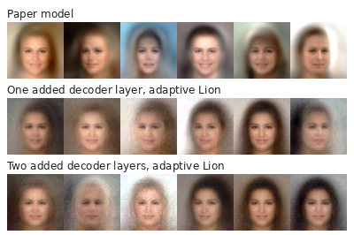

Reuse `portrait_args` above to train either model. The added layers use a Gaussian width of 0.50. The adaptive optimizer uses one shared schedule and updates its multiplier for each neuron.

```bash
for depth in 2 3; do
  OPENBLAS_NUM_THREADS=2 python -m experiments.celeba "${portrait_args[@]}" \
    --vector-hidden-depth "$depth" --rule lion-adaptive-agreement \
    --full-only --full-epochs 2 --checks-per-epoch 2 \
    --output "runs/celeba-decoder-adaptive/depth${depth}-full-lion-adaptive-agreement"
done
```

For the pilots, use `--pilot-only --pilot-images 8192 --epochs 2` in place of the full-run options and choose a separate output directory for each depth and rule. Use `--rule lion` for the matched ordinary Lion run.

### Explicit and semi-implicit Lion

These are the two weight updates in Section 3.3 of *Supervised Hebbian Class Networks*. Both use the direction and coactivity history from Eq. (7). Here $w$ is a weight before the minibatch, $D$ is the signed direction scaled for the number of incoming coefficients, $Q$ is the receiving neuron's mean squared activity over contributing observations, and $\eta$ is the layer's step size. [Loverich, Eqs. (7)–(9)](https://arxiv.org/html/2611.24314v1#S3.SS3)

| Rule | Weight after the minibatch |
| --- | --- |
| Semi-implicit Lion, Eq. (8) | $(w + \eta D)/(1 + \eta Q)$ |
| Explicit Lion, Eq. (9) | $w + \eta D - \eta Qw$ |

At the same weight and with the same minibatch statistics, the explicit step is $1+\eta Q$ times the semi-implicit step. Subsequent minibatches can give different activities and teaching signs as the weights diverge.

The paired runs use matching architectures, initial weights, minibatch orders, step sizes, schedules and checkpoint selection. Each model uses its assigned Lion update throughout. Every coordinate run starts at 0.00075 across all layers and uses one cosine from start to finish. Checkpoints are selected for reporting after training.

| Experiment | Error measured | Semi-implicit | Explicit |
| --- | --- | ---: | ---: |
| Sine, 1 × 512 | Median test RMSE | 0.08230 | 0.12728 |
| Sine, 4 × 64 | Median test RMSE | 0.03615 | 0.03943 |
| Sine, 12 × 64 | Median test RMSE | 0.03270 | 0.02793 |
| Sine, 24 × 64 | Median test RMSE | 0.03402 | 0.03504 |
| Blue Marble, Gaussian | Summed squared RGB error over all pixels | 208.31 | 224.54 |

Each row of the sine figure shows both variants from the same initialization. [Semi-implicit measurements](../assets/results/sine-jump-fit-cosine-all-lion.json) · [Explicit measurements](../assets/results/sine-jump-fit-cosine-all-lion-explicit.json)

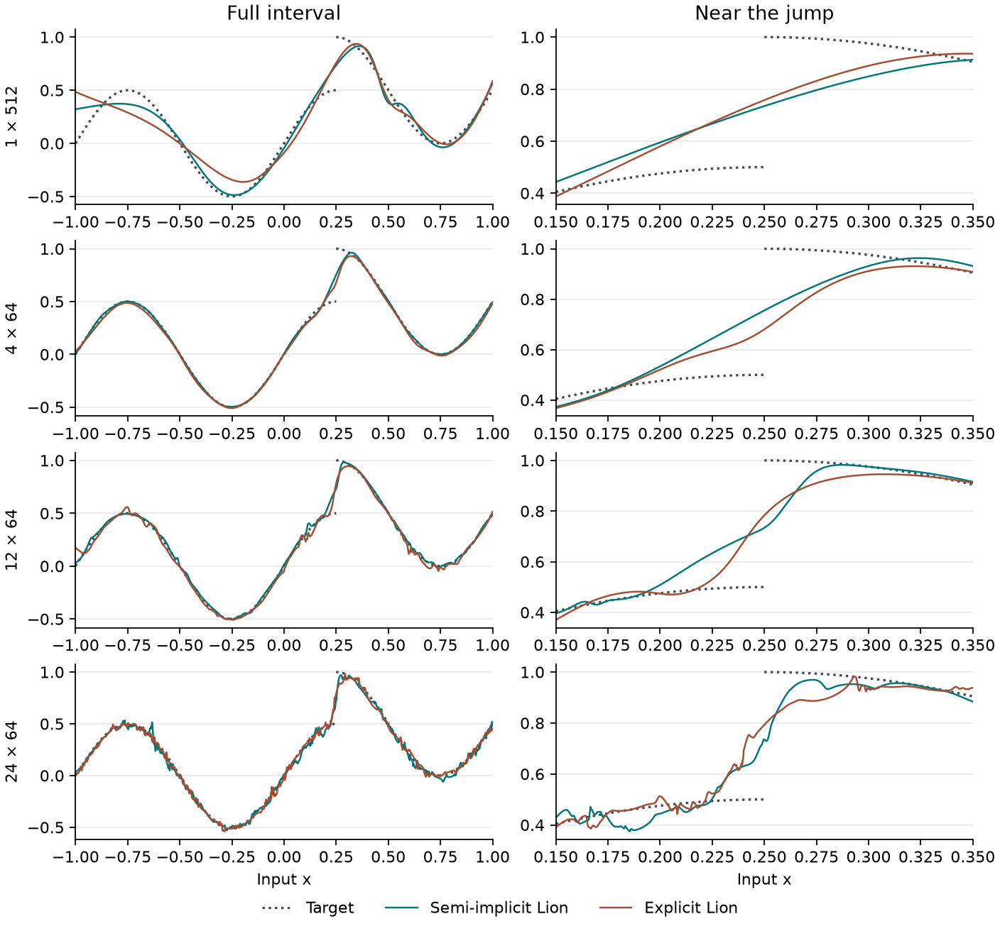

Both Blue Marble Lion runs above use Gaussian competition. We also tested the original class network's hard selection with semi-implicit Lion. In each 72-neuron class it keeps the $K$ largest magnitudes, preserves their signs, and sets the other activities to zero. All runs use 12 layers of 432 neurons, the same initial weights, the same signed regression output and the same cosine schedule. [Loverich, Section 2.1](https://arxiv.org/html/2611.24314v1#S2.SS1)

| Blue Marble competition | Error at 16,384 pixels | Error against bilinear interpolation between pixels |
| --- | ---: | ---: |
| Gaussian | 208.31 | 108.61 |
| Top-K, K=8 | 696.88 | 537.40 |
| Top-K, K=18 | 415.91 | 281.50 |
| Top-K, K=36 | 418.00 | 278.82 |
| Top-K, K=54 | 510.96 | 349.37 |

The lowest Top-K error at the original pixels was **415.91** with **K=18**, 99.7% higher than Gaussian at this width and step size. [Convergence curves](../assets/results/blue-marble-competition-convergence.png) · [Gaussian measurements](../assets/results/blue-marble-output-depth-12-cosine-lion-all-pixels.json) · [Explicit Lion measurements](../assets/results/blue-marble-output-depth-12-cosine-lion-explicit-all-pixels.json) · [K=8 measurements](../assets/results/blue-marble-output-depth-12-cosine-top-k-8-lion-all-pixels.json) · [K=18 measurements](../assets/results/blue-marble-output-depth-12-cosine-top-k-18-lion-all-pixels.json) · [K=36 measurements](../assets/results/blue-marble-output-depth-12-cosine-top-k-lion-all-pixels.json) · [K=54 measurements](../assets/results/blue-marble-output-depth-12-cosine-top-k-54-lion-all-pixels.json)

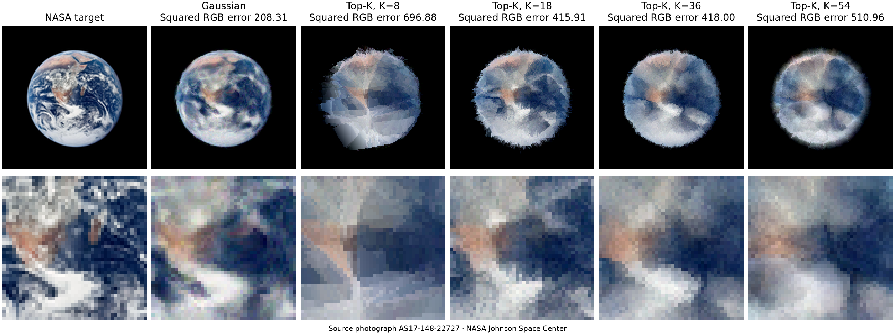

[Blue Marble fits for both Lion updates](../assets/results/blue-marble-lion-fits.png)

On CelebA, mean summed squared RGB error per test image was **184.19** with semi-implicit Lion and **184.11** with explicit Lion. The 256-value models use the same two-pass training schedule and the same RGB Gaussian width of 0.40 for inference. Explicit Lion reduced mean reconstruction error by 0.04% and had lower squared RGB error on 10,421 of 19,962 test images. The decoder panels use the same sampler settings fitted to each model's training embeddings. [Measurements](../assets/results/celeba-256-lion-explicit.json) · [Explicit Lion decoder samples](../assets/results/celeba-256-lion-explicit-portraits.png) · [Semi-implicit Lion decoder samples](figures/portraits.png)

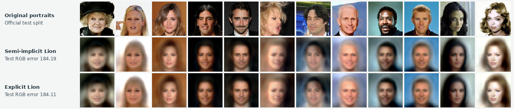

Run both variants and render the paired figures from the repository root.

```bash
for rule in lion lion-explicit; do
  OPENBLAS_NUM_THREADS=1 python -m papers.lion sine --rule "$rule" --workers 4
  OPENBLAS_NUM_THREADS=2 python -m papers.lion marble --rule "$rule"
done
python -m papers.lion sine-figures
python -m papers.lion marble-figures
for k in 8 18 36 54; do
  OPENBLAS_NUM_THREADS=2 python -m papers.lion marble --rule lion --top-k "$k"
done
python -m papers.lion marble-competition --sweep
```

For CelebA, use the training command in the CelebA section with `--rule lion-explicit` and `run=runs/celeba-sequential/full/code256-balanced-lite-long-lion-explicit`. Then run

```bash
OPENBLAS_NUM_THREADS=4 python -m experiments.celeba_prior "$run/full" --vector-gate-width .40 \
  --components 16 --local-rank 64 --local-scale .85 --output "$run/full/decoder-mixture-selected.npz"
python -m papers.lion portraits --run "$run/full"
```

### Immediate per-weight scaling

For Blue Marble, we test a per-weight step in the semi-implicit update. If current signed coactivity and its running average before the update agree in sign, multiply the scheduled step by 1.5. If they disagree, multiply by 0.5. If either is zero, use the scheduled step. This scales both the signed increment and the activity-dependent shrinkage. The same rule applies in every layer. The run uses Gaussian competition, batches of 128, and the same 560-epoch cosine as its uniform-timestep control, starting at 0.00075.

The agreement rule reaches **212.22** summed squared RGB error at epoch 485. The original Lion rule reaches **208.31** at epoch 505. Around the agreement run’s selected checkpoint, mean timesteps across the 12 layers ranged from **0.991× to 1.005×** the scheduled step, with each mean computed over the preceding five epochs. [Convergence curves](../assets/results/blue-marble-lion-agreement-convergence.png) · [Mean timestep by layer](../assets/results/blue-marble-lion-agreement-timesteps.png) · [Measurements](../assets/results/blue-marble-output-depth-12-cosine-lion-agreement-all-pixels.json)

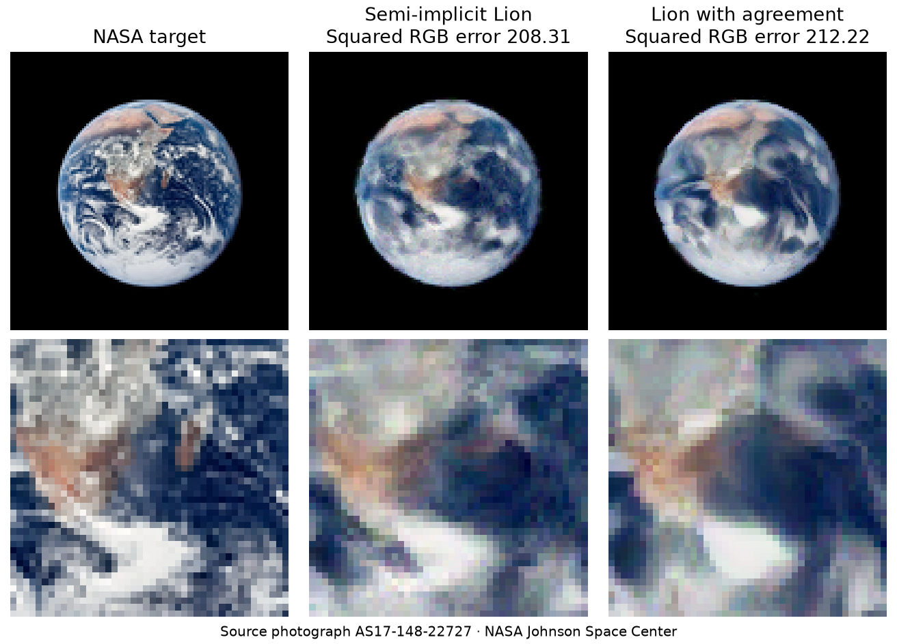

```bash
OPENBLAS_NUM_THREADS=2 python -m papers.lion marble --rule lion
OPENBLAS_NUM_THREADS=2 python -m papers.lion marble --rule lion-agreement
```

### Blue Marble batch size

We reran semi-implicit Lion with batch size 64 from initialization. Both runs use every pixel, the same initial weights and pixel order, and one 560-epoch cosine starting at 0.00075. Batch size 64 gives 143,360 updates over the run. Batch size 128 gives 71,680.

| Batch size | Best summed squared RGB error | Selected epoch |
| ---: | ---: | ---: |
| 128 | **208.31** | 505 |
| 64 | 209.25 | 560 |

The earlier two-stage run reached 23.94 with different step sizes and a different schedule. A constant batch size of 64 with the single cosine produced a similar fit to batch size 128. [Convergence curves](../assets/results/blue-marble-batch-64-convergence.png) · [Batch-64 measurements](../assets/results/blue-marble-output-depth-12-cosine-batch-64-lion-all-pixels.json) · [Earlier run](../assets/results/blue-marble-output-depth-12-two-phase-all-lion-all-pixels.json)

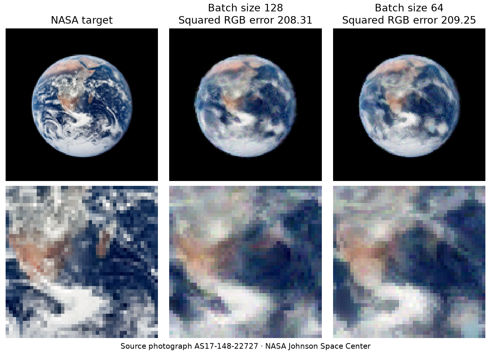

```bash
OPENBLAS_NUM_THREADS=2 python -m papers.lion marble --rule lion --batch 64
```

### Lion with a limit on neuron response changes

For each neuron, compute the ordinary semi-implicit Lion weight increment $\Delta w$ and the change $U\Delta w$ it would produce before competition, holding the current batch of input activities $U$ fixed. If its root mean square exceeds $c\,\mathrm{RMS}(Uw)$, scale down the increment so the change meets that limit. This scales both the signed increment and the activity-dependent shrinkage. Every neuron uses the same $c$ at each update, and the final residual still supplies only its sign. The timestep and $c$ both decay along the same cosine.

The six 200-epoch trials pair two starting timesteps (0.00075 and 0.003) with three initial response limits (0.0375%, 0.075%, and 0.3%). Original Lion runs at both timesteps provide matched controls. Every run uses batches of 128 and all 16,384 pixels.

The 200-epoch results report best summed squared RGB error.

| Starting timestep | Original Lion | 0.0375% limit | 0.075% limit | 0.3% limit |
| ---: | ---: | ---: | ---: | ---: |
| 0.00075 | 238.19 | 407.07 | 290.56 | **236.33** |
| 0.003 | **221.51** | 437.20 | 362.31 | 391.66 |

The earlier two-stage fit had error 70.20 at epoch 200. At 25,600 updates, the full budget of each pilot, the earlier run had reached epoch 140 and error 83.88. We stopped the two 560-epoch follow-ups after reviewing this gap. [Earlier run](../assets/results/blue-marble-output-depth-12-two-phase-all-lion-all-pixels.json) · [Pilot convergence](../assets/results/blue-marble-lion-response-pilot.png) · [Pilot measurements](../assets/results/blue-marble-lion-response.json) · [Timestep multipliers for the best capped pilot](../assets/results/blue-marble-lion-response-pilot-timesteps.png)

```bash
OPENBLAS_NUM_THREADS=1 python -m experiments.blue_marble_response --workers 8
```

### Fixed layer timesteps under one cosine

Both Blue Marble runs start from the same weights and use semi-implicit Lion, batches of 64, and one 560-epoch cosine. The uniform run starts every layer at 0.0015. The scaled run starts the final layer at 0.0015 and multiplies the timestep by 0.7 for each layer toward the input.

| Minibatch updates | Uniform timestep | Scaled timesteps | Historical two-stage run |
| ---: | ---: | ---: | ---: |
| 12,800 | 417.71 | 282.02 | 164.43 |
| 25,600 | 469.12 | 209.71 | 83.88 |
| 38,400 | — | 170.81 | 72.05 |

Entries show the summed squared RGB error at the stated update count. The uniform run stopped at epoch 100 and had its best checkpoint at epoch 80 with error 409.44. The scaled run continued on the original cosine to epoch 150, preserving the current weights and Lion history. It reached 170.81, still 2.37 times the historical error at equal updates, and training paused there. [Convergence](../assets/results/blue-marble-layer-steps-convergence.png) · [Run settings and measurements](../assets/results/blue-marble-layer-steps.json)

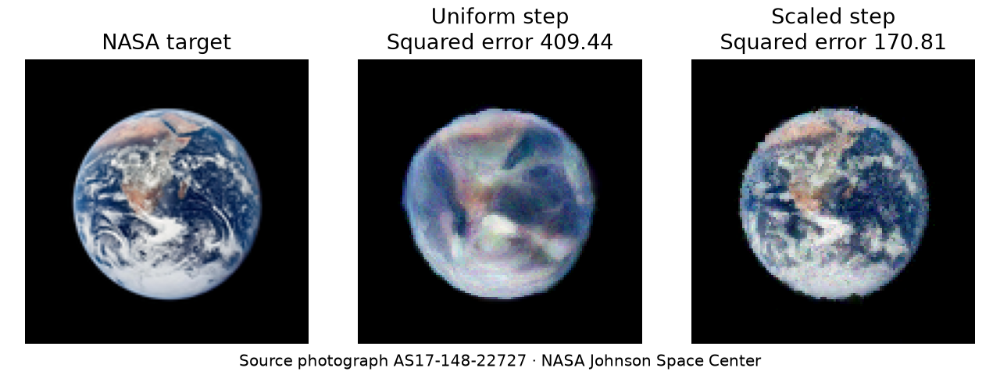

```bash
OPENBLAS_NUM_THREADS=2 python -m experiments.blue_marble_layer_steps --scaled-until 150
```

### Normalizing the features passed between layers

For each coordinate, we divided each hidden layer’s Gaussian-gated feature vector by $\sqrt{\mathrm{mean}(h^2)+10^{-6}}$ before feeding it to the next layer. The layer’s RGB estimate and its postsynaptic Hebbian observation used the original gated values. Each receiving layer used the normalized features as its presynaptic inputs. This normalization has no learned gain or offset. The control and normalized model used identical initial weights, pixel order, batches of 64, and a single cosine with initial timestep 0.0015 shared by every layer.

At epoch 50 (12,800 updates), summed squared RGB error was **417.71** in the control and **1,278.13** with RMS normalization. We stopped the normalized run there. At initialization, **44.08%** of the normalized model’s pooled RGB channel predictions exceeded the nominal range in magnitude, compared with **0.39%** in the control. Enforcing unit RMS on the transmitted features changed the scale seen by the existing magnitude-sum output. [Convergence curves](../assets/results/blue-marble-interlayer-rms-convergence.png) · [Measurements](../assets/results/blue-marble-interlayer-rms.json)

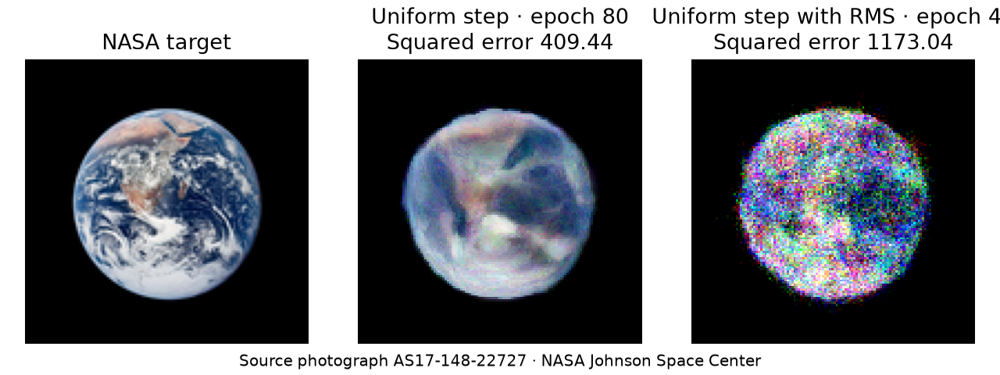

```bash
OPENBLAS_NUM_THREADS=2 python -m experiments.blue_marble_layer_steps --normalization --until 50
```

We also divided each gated feature vector by its maximum absolute value across all 432 neurons, separately for each pixel and each hidden-to-hidden connection. An all-zero vector stays zero. At initialization, 1.77% of pooled RGB predictions exceeded the nominal range. The table compares all three runs over the first 50 epochs, with error measured every five epochs.

| Interlayer normalization | Error at epoch 50 | Lowest measured error through epoch 50 | Epoch of minimum |
| --- | ---: | ---: | ---: |
| None | 417.71 | 417.71 | 50 |
| Max-abs | 500.02 | 420.69 | 40 |
| RMS | 1,278.13 | 1,173.04 | 40 |

We stopped the max-abs run at epoch 50. Its lowest error was close to the control’s. The historical two-stage run had reached 164.43 at the same 12,800 updates. [Convergence curves](../assets/results/blue-marble-interlayer-max-abs-convergence.png) · [Measurements](../assets/results/blue-marble-interlayer-max-abs.json)

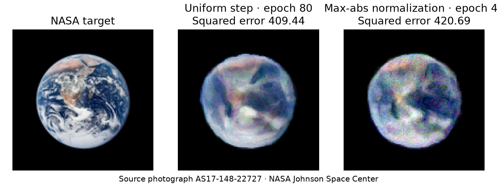

```bash
OPENBLAS_NUM_THREADS=2 python -m experiments.blue_marble_layer_steps --normalization max-abs --until 50
```

### Batch size during refinement

Both runs loaded the historical epoch-80 weights and Lion history, with starting error 259.76. They used the recorded second-stage schedule and a starting timestep of 0.0015 in the final layer, multiplied by 0.7 for each layer toward the input. The schedule holds the timestep constant over the measured window. Both runs used the same pixel order per epoch.

| Budget after the checkpoint | Batch 64 | Batch 128 |
| --- | ---: | ---: |
| 10 epochs, equal pixels processed | **164.43** | 185.75 |
| 2,560 updates | 164.43 (10 epochs) | **143.66** (20 epochs) |

The batch-64 replay matched the archived scores exactly. Keeping batch 128 reached 163.73 after 15 epochs and 1,920 updates. The early error drop therefore carries over to constant batch size, with a tradeoff between passes over the image and minibatch updates. This experiment covers the first 20 epochs of refinement. [Convergence by epoch and update count](../assets/results/blue-marble-refinement-batch-size.png) · [Measurements](../assets/results/blue-marble-refinement-batch-size.json)

To reproduce the comparison with the archived epoch-80 checkpoint, run

```bash
OPENBLAS_NUM_THREADS=2 python -m experiments.blue_marble_batch_switch
```

### One cosine with the layer taper

The previous Blue Marble baseline starts from the original initialization and uses semi-implicit Lion, batch size 128, and one 560-epoch cosine starting at 0.004. The same timestep applies to every layer through epoch 80. From epoch 81 onward, each layer uses 0.7 times the timestep of the layer after it. The final layer takes the current cosine value, which is about 0.003802 at the transition. The first layer takes about 0.0000752, or 1.98% of the final layer's timestep. The run carries its current weights and coactivity history through the transition and uses the historical pixel permutations for the corresponding epochs.

| Run | Best summed squared RGB error | Error at epoch 560 | Updates through epoch 560 |
| --- | ---: | ---: | ---: |
| One cosine, batch 128 | **23.56** (epoch 520) | 23.95 | 71,680 |
| Historical two-stage run, batches 128 then 64 | 23.94 (epoch 560) | 23.94 | 133,120 |

The constant-batch, single-cosine run matched the historical final error to within 0.004 and used 46% fewer updates over the same 560 passes through the image. The separate batch-128 replay with two cosines was measured through epoch 100, where it scored 143.66 and the single-cosine run scored 170.90. [Convergence curves](../assets/results/blue-marble-single-cosine-taper.png) · [Run settings and measurements](../assets/results/blue-marble-single-cosine-taper.json)

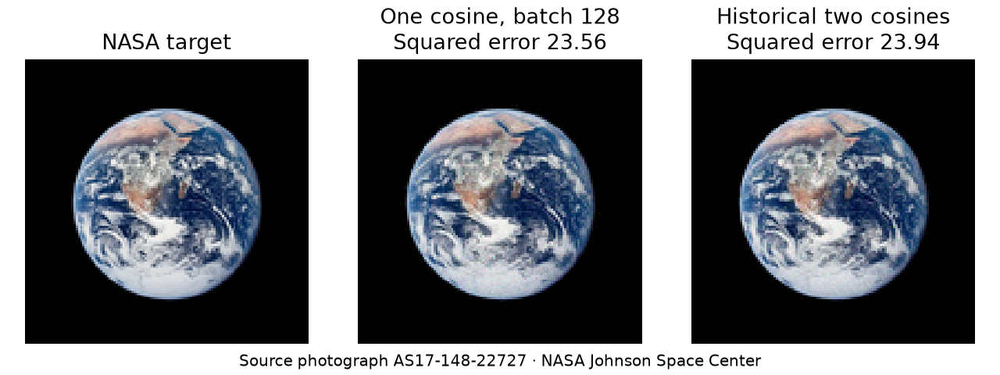

```bash
OPENBLAS_NUM_THREADS=2 python -m experiments.blue_marble_single_cosine --until 560
```

### One shared timestep with coactivity adaptation

Every layer uses the same 560-epoch cosine, starting from initialization with batches of 128. For each synapse, the optimizer tracks the ordinary Lion coactivity average and a second average of its absolute value, both with decay 0.99. The ratio of the magnitude of the signed average to the absolute average multiplies the scheduled step. Repeatedly reversing observations reduce the rate, and a persistent sign approaches the full scheduled step. The rule reads the same signed class teaching signal as ordinary Hebbian Lion and uses no layer index.

| Update and shared starting timestep | Epoch measured | Error at that epoch |
| --- | ---: | ---: |
| Coactivity ratio, 0.004 | 100 | 210.85 |
| Coactivity ratio, 0.004 | 200 | 159.55 |
| Coactivity ratio, 0.004 | 300 | 141.05 |
| Coactivity ratio, 0.016 | 100 | 394.34 |
| Sign of the coactivity average with the same ratio, 0.004 | 100 | 588.01 |
| Sign of the coactivity average with the same ratio, 0.01 | 50 | 1,369.76 |
| Squared coactivity ratio, 0.016 | 100 | 600.68 |
| Coactivity ratio with additional shrinkage for weak signals, 0.009 | 100 | 233.03 |
| Coactivity ratio with additional shrinkage for weak signals, 0.009 | 200 | 169.94 |
| Tapered baseline | 100 | **170.90** |
| Tapered baseline | 200 | **76.49** |
| Tapered baseline | 300 | **62.26** |

The 0.004 coactivity-ratio run averaged 3.1% of the scheduled step in its first layer and 44.6% in its final layer near epoch 200. Its early shuffles match the tapered run, which changes its shuffle stream at epoch 81. Both runs see the same number of pixels and minibatch updates at equal epochs. [Convergence curves](../assets/results/blue-marble-shared-step-lion-coherence-0.004.png) · [Measurements](../assets/results/blue-marble-shared-step-lion-coherence-0.004.json)

```bash
OPENBLAS_NUM_THREADS=2 python -m experiments.blue_marble_shared_step --rule lion-coherence --rate .004 --until 200
```

Further pilots also left the layer timestep uniform. At epoch 50, scaling by relative input energy scored 539.20, scaling the proposed change in the neuron's response scored 542.65, using a unit-length coactivity direction scored 719.27, and using the cosine between input activity and the signed postsynaptic response scored 517.49. These runs stopped at that checkpoint. [Input energy](../assets/results/blue-marble-shared-step-lion-input-scale-0.004.json) · [Relative response](../assets/results/blue-marble-shared-step-lion-relative-response-0.004.json) · [Unit-length direction](../assets/results/blue-marble-shared-step-lion-coactivity-direction-0.004.json) · [Cosine coactivity](../assets/results/blue-marble-shared-step-lion-cosine-coactivity-0.02.json)

The tapered Blue Marble checkpoint's median squared weight norm is about 52 times larger in the final layer than in the first. Using each neuron's squared incoming weight norm as its timestep multiplier took 565.81 error at epoch 50 with a shared starting step of 0.0015. One layer averaged a multiplier of 73.1, so this pilot was stopped. The bounded form caps that multiplier at one. [Unbounded weight-power pilot](../assets/results/blue-marble-shared-step-lion-weight-power-0.0015.json)

| Follow-up update | Shared starting step | Error at epoch 100 |
| --- | ---: | ---: |
| Squared weight norm | 0.00075 | 380.66 |
| Squared weight norm capped at one | 0.004 | 397.56 |
| Coactivity ratio times capped squared weight norm | 0.008 | 253.88 |
| Coactivity multiplier averaged over each neuron's incoming weights | 0.009 | **208.94** |

The neuron-level version uses the same coactivity shrinkage for weak signals as the per-synapse pilot above. It then applies the mean multiplier across each neuron's incoming weights to its whole update. Its error reached 173.24 at epoch 200, compared with 159.55 for the simpler per-synapse coactivity ratio. [Neuron-level convergence](../assets/results/blue-marble-shared-step-lion-neuron-coherence-0.009.png) · [Measurements](../assets/results/blue-marble-shared-step-lion-neuron-coherence-0.009.json)

Feeding the original feature vector directly into every layer gave error 414.98 at epoch 100 with ordinary Lion and a shared step of 0.0015, and 240.49 with the neuron-level coactivity rule at 0.009. Every layer still receives the previous layer's features and updates its own connections. [Ordinary Lion with direct inputs](../assets/results/blue-marble-shared-step-lion-0.0015-skip-input.json) · [Neuron-level coactivity with direct inputs](../assets/results/blue-marble-shared-step-lion-neuron-coherence-0.009-skip-input.json)

Keeping each receiving neuron's incoming weight vector at unit norm gave 371.46 error at epoch 100. Predicting from the final layer alone with the coactivity ratio gave 7,051.36 at epoch 50. [Unit-norm weights](../assets/results/blue-marble-shared-step-lion-0.0015-unit-norm.json) · [Final-layer prediction](../assets/results/blue-marble-shared-step-lion-coherence-0.004-last-output.json)

### Shared step scaled by activity coverage

For each receiving neuron, the rule divides the sum of squared Gaussian-gated activities by the square of the sum of their absolute values over the batch. This is the inverse of the effective number of examples on which the neuron responds. One active example gives a multiplier of one. Equal activity on every example gives one divided by the batch size. The ratio multiplies the usual Lion step and uses no extra history. The squared error reached 274.21 at epoch 100 from initialization, with a shared starting step of 0.004. [Training curve and measurements](../assets/results/blue-marble-shared-step-lion-participation-0.004.json)

The refinement diagnostic loaded the historical epoch-80 checkpoint and Lion history, then trained for 20 epochs with batches of 128. Both the original taper and the activity-coverage trials saw the same pixels in the same order. The power variant raises the inverse effective count to 1.5 to give broader activations a smaller step.

| Refinement update | Shared step | Error after 20 epochs |
| --- | ---: | ---: |
| Historical layer taper | 0.0015 in the final layer | 143.66 |
| Inverse effective count | 0.004 | 179.94 |
| Inverse effective count | 0.008 | 213.55 |
| Inverse effective count to the power 1.5 | 0.008 | 179.10 |
| Inverse effective count to the power 1.5 | 0.012 | 188.47 |
| Mean inverse effective count within a competition pool, to the power 1.5 | 0.008 | **122.68** |

The pool version averages the inverse effective count of the responding neurons in each existing competition pool, then raises that average to 1.5. The same multiplier serves both signed classes in the pool. Its error fell from 259.76 to 122.68 over the 20-epoch replay, compared with 143.66 for the taper. The replay measures refinement of an existing fit. [Linear coverage, 0.004](../assets/results/blue-marble-participation-refinement-0.004.json) · [Linear coverage, 0.008](../assets/results/blue-marble-participation-refinement-0.008.json) · [Coverage power, 0.008](../assets/results/blue-marble-participation-power-refinement-0.008.json) · [Coverage power, 0.012](../assets/results/blue-marble-participation-power-refinement-0.012.json) · [Pool coverage](../assets/results/blue-marble-pool-participation-refinement-0.008.json)

```bash
OPENBLAS_NUM_THREADS=2 python -m experiments.blue_marble_shared_step --participation-refinement lion-participation-power --rate .008
OPENBLAS_NUM_THREADS=2 python -m experiments.blue_marble_shared_step --refinement lion-pool-participation --rate .008
```

From initialization, the coverage rule at 0.012 reached 313.65 at epoch 100, and multiplying the coactivity ratio by the square root of inverse coverage reached 226.10 at a shared step of 0.012. Smoothing the inverse coverage with a 0.99 moving average starting at one gave error 239.36 at epoch 100 with a shared step of 0.004. [Coverage at 0.012](../assets/results/blue-marble-shared-step-lion-participation-0.012.json) · [Coactivity with coverage](../assets/results/blue-marble-shared-step-lion-selective-coherence-0.012.json) · [Smoothed coverage](../assets/results/blue-marble-shared-step-lion-smoothed-participation-0.004.json)

Starting from initialization, pool coverage at 0.008 reached 241.12 at epoch 100. A 0.9995 moving average of each neuron's inverse effective count raised to the power 1.5, initialized at one, reached 116.22 at epoch 100 and 73.89 at epoch 200 with a shared starting step of 0.006. Its best error was 42.91 at epoch 340. The run stopped at epoch 350 after sign agreement had reached 21.02 at epoch 300. [Pool coverage from initialization](../assets/results/blue-marble-shared-step-lion-pool-participation-0.008.json) · [Slow moving average of coverage](../assets/results/blue-marble-shared-step-lion-slow-participation-power-0.006.json)

```bash
OPENBLAS_NUM_THREADS=1 python -m experiments.blue_marble_shared_step --rule lion-slow-participation-power --rate .006 --until 350
```

### One shared timestep with sign agreement

Each neuron starts with a step multiplier $g_j=1$. In each minibatch, $a_j$ is the average sign agreement between its current Hebbian coactivity and its old Lion history over its incoming weights and bias. A nonzero match adds $+1$, a reversal adds $-1$, and a zero on either side adds $0$ before averaging. The neuron uses $a_j$ to update $g_j$ by multiplying it by $0.99^{-a_j}$ and clipping it to $[0.01,1]$. The resulting step $\eta_t g_j$ replaces the shared cosine step $\eta_t$ in both parts of the semi-implicit weight update for that minibatch.

On Blue Marble, the agreement rule uses the same 12-layer architecture, batch size 128 and 560-epoch cosine starting at 0.004. Its summed squared RGB error reached **6.82** at epoch 560. The tapered run reached a best error of **23.56** at epoch 520, which the agreement run first bettered at epoch 285. The mean step factors for the agreement rule at epoch 100 were 0.010 in the first layer and 0.949 in the last. [Convergence](../assets/results/blue-marble-shared-step-lion-adaptive-agreement-0.004.png) · [Measurements](../assets/results/blue-marble-shared-step-lion-adaptive-agreement-0.004.json)

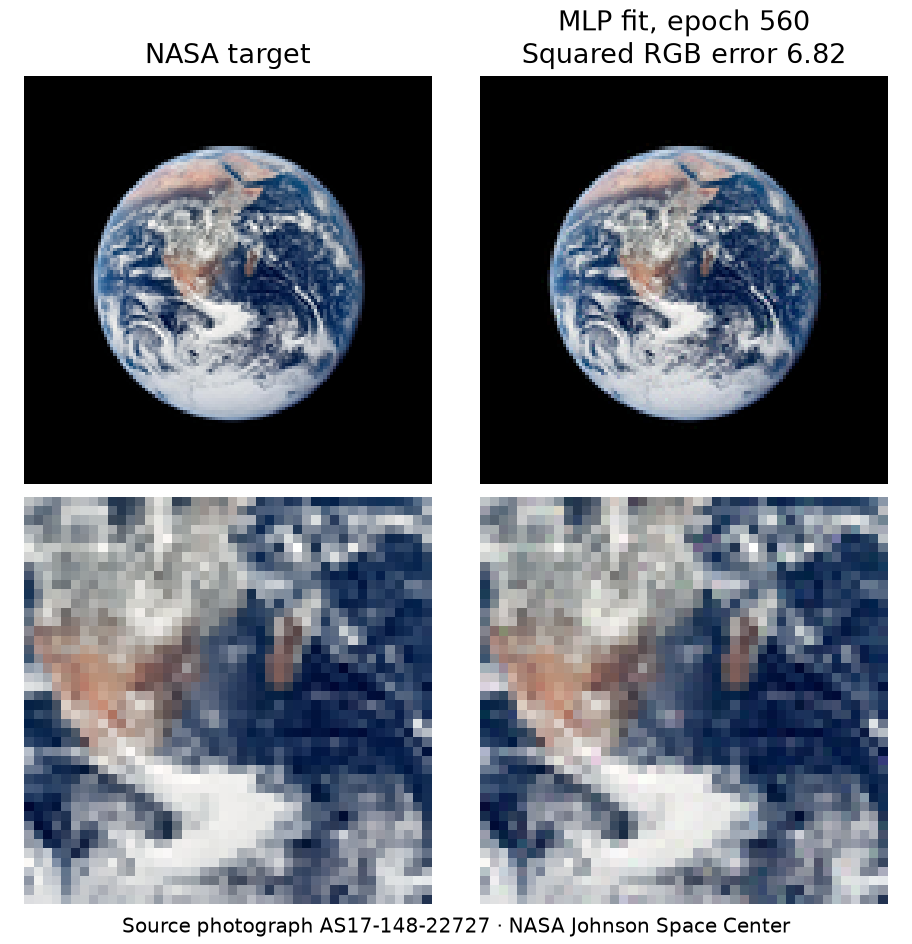

The 12-layer discontinuous-sine comparison keeps the architecture, Gaussian widths, batch size of 64 and 640-epoch cosine starting at 0.00075 the same. The table gives median test measurements. Transition width measures the interval over which the fit rises from 10% to 90% of the target jump. [Ordinary Lion measurements](../assets/results/sine-jump-fit-cosine-all-lion.json) · [Adaptive Lion measurements](../assets/results/sine-jump-fit-cosine-adaptive-agreement-12-layers.json)

| Update | Test RMSE | RMSE away from the jump | Transition width |
| --- | ---: | ---: | ---: |
| Ordinary Lion | 0.03270 | 0.01566 | 0.03920 |
| Lion with sign agreement | **0.01697** | **0.00384** | **0.02326** |

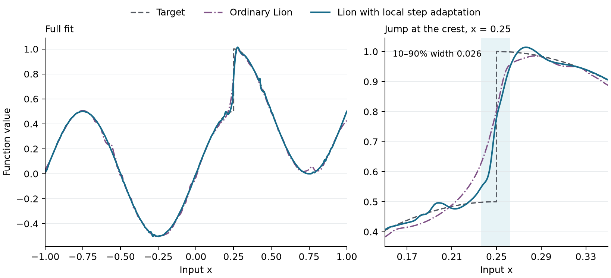

```bash
OPENBLAS_NUM_THREADS=1 python -m papers.lion sine --rule lion-adaptive-agreement --depth 12 --workers 3
OPENBLAS_NUM_THREADS=2 python -m experiments.blue_marble_shared_step --rule lion-adaptive-agreement --rate .004 --until 560 --fits
```

### Other shared-step controls

Ordinary Lion with a shared starting step of 0.0015 and batch size 512 reached error 402.05 after 200 epochs (6,400 updates). The 128-batch tapered baseline reached 548.70 at 6,400 updates and 76.49 after the same 200 passes through the image. The larger-batch pilot uses a single cosine over the same total planned update count. [Larger minibatches](../assets/results/blue-marble-shared-step-lion-0.0015-batch-512.json)

Capping the fourth power of the receiving neuron's weight norm at one gave error 372.85 at epoch 100 with a shared starting step of 0.004. Smoothing the activity-coverage multiplier gave error 181.51 at epoch 200, compared with 76.49 for the taper. [Bounded weight-norm pilot](../assets/results/blue-marble-shared-step-lion-bounded-weight-fourth-0.004.json) · [Smoothed coverage](../assets/results/blue-marble-shared-step-lion-smoothed-participation-0.004.json)

Centering the presynaptic features for the Hebbian update and translating the bias back to the original coordinates gave error 382.98 with a shared starting step of 0.0015 and 704.18 at 0.004, both at epoch 100. The centered update leaves the forward calculation unchanged. [Centered update at 0.0015](../assets/results/blue-marble-shared-step-lion-centered-0.0015.json) · [Centered update at 0.004](../assets/results/blue-marble-shared-step-lion-centered-0.004.json)

| Shared-step control | Error | Epoch |
| --- | ---: | ---: |
| One denominator for the signed step across all connections | 346.56 | 100 |
| One Gaussian competition width of 0.16 in all 12 layers | 393.61 | 100 |
| Four layers of 864 neurons, with Gaussian width 0.16 | 392.31 | 100 |
| Shrinkage proportional to squared absolute activity sum over the contributing examples | 834.67 | 50 |
| Geometric mean of that shrinkage and ordinary Lion shrinkage | 664.62 | 50 |

The first three experiments use a shared step of 0.0015 and the final two use 0.004. All use one cosine and batches of 128. [Equal signed step](../assets/results/blue-marble-shared-step-lion-uniform-sign-step-0.0015.json) · [One Gaussian width](../assets/results/blue-marble-shared-step-lion-0.0015-gate-0.16.json) · [Four wider layers](../assets/results/blue-marble-shared-step-lion-0.0015-4x864-gate-0.16.json) · [Coverage shrinkage](../assets/results/blue-marble-shared-step-lion-coverage-decay-0.004.json) · [Geometric-mean shrinkage](../assets/results/blue-marble-shared-step-lion-sqrt-coverage-decay-0.004.json)

Starting from the historical coarse fit at error 259.76, ordinary Lion with a uniform step of 0.00041 reached 261.90 after 20 refinement epochs. Reducing the shared step to 0.0002 gave 260.96. The same checkpoint reached 143.66 with the taper at the same batch size and pixel order. The shared step of 0.00041 approximates the mean of the twelve historical layer steps. [Uniform step 0.00041](../assets/results/blue-marble-uniform-lion-refinement-0.00041.json) · [Uniform step 0.0002](../assets/results/blue-marble-uniform-lion-refinement-0.0002.json)
